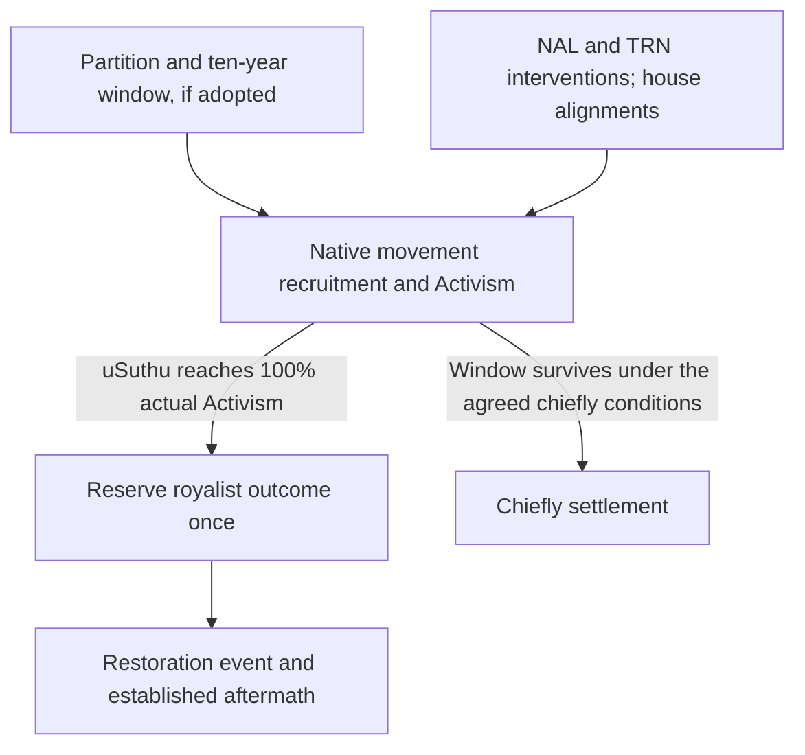

# Thirteen Chiefdoms: military non-intervention and persistent houses

**9 November 2026 — historical design exploration.** DP subsequently approved the
recommendations, mixed-law waiting and head-led aggregate representation. The
[current implementation record](zulu_thirteen_chiefs_implementation_2026_11_10.md)
records the 10 November source change; native-war non-intervention remains an
engine gate. The proposal text below is preserved as the original evidence.

Continues the [timer and house-view exploration](zulu_thirteen_chiefs_timer_and_houses_2026_11_08.md).
DP corrects the proposed royalist threshold to **100% actual Activism** and does
not accept a native civil war unless Natal and, through it, Britain can be kept
out. This is a condition on the war proposal, not approval to implement it.
DP also proposes persistent houses, with new houses introduced where appropriate,
and a nested head/Prominence/allegiance/member display in both JEs.

## Decision register

| Item | Status | Direction |
| --- | --- | --- |
| Royalist threshold | Clarified by DP | 100% actual Activism; the preceding Support discussion does not describe DP's intended threshold. |
| Native civil war | Conditional / unresolved | Acceptable only if NAL and GBR can reliably be excluded. No assurance from static eligibility checks alone. |
| Ten-year objective | Still open | Retain the prior discussion; the choice of military or event resolution affects what the deadline means. |
| Persistent houses | Requested direction | Stable political identities with changing members, leadership and allegiance; exact leadership continuity below remains provisional. |
| Shared house presentation | Requested direction | One underlying roster, shown in Prerogative and the international situation through nested expansion. |
| amaKhosi | Prior provisional recommendation | Keep its recruitment and law-pressure role; no new approval inferred from this turn. |
| Payer-G prices and competing-revolt restriction | Prior requirements | Preserve the refinement scope; do not silently alter existing bribe target selection. |

### Remaining decisions after DP's follow-up

DP asks for the last decisions and has commissioned separate research into
potential fixed historical houses. The following are recommendations awaiting
agreement, not an implementation instruction:

| Decision | Recommended first pass | Alternative or consequence |
| --- | --- | --- |
| Conflict outcome and foreign participation | If verified isolation is possible, 100% actual uSuthu Activism permits a native outbreak; the actual winner decides. Keep foreign regular armies out on both sides, with NAL and TRN intervening through the JE. | DP has required NAL/GBR exclusion, not yet TRN exclusion. If isolation fails, the proposed fallback is a restoration event at 100% Activism; this fallback still needs acceptance. |
| Chiefly settlement clock | Review at a fixed ten-year date. Award the chiefly result only with its complete constitutional pair and Natal's actual subject relationship intact. An organising or active constitutional conflict defers the verdict without resetting the clock. | Accumulating calm months is a different endurance model and can extend the contest indefinitely. No unrelated-war peace condition or Prerogative threshold is proposed. |
| amaKhosi | Retain its native movement, chiefly-law pressure and attraction as Natal's constructive intervention target. | Removing it requires revising both the intervention tools and its existing contribution to institutional backing. |
| House leadership continuity | Stabilise house identities while retaining current Prominence-based head selection initially. | Holding a valid head until a vacancy or explicit removal is a separate political change; it would prevent ordinary Prominence changes from transferring representation. |

The proposed suppression scope is competing **ideological revolutions** during
the exact partition contest. Blocking unrelated cultural or religious secessions
as well would broaden that scope and is not assumed approved. In the event-only
fallback, the constitutional movements' native uprising paths must also be
gated, as described below.

Carry forward existing subject outcomes, incorporation entitlements and earned
NRP promises. Retain P/IR's governing effects while removing the partition's
dependence on the royal-household JE. The proposed foreign-bribe price uses the
existing doubled domestic payer-G curve, a frozen quote and permitted debt.
These are carry-forward defaults for the refinement, not new balance changes.

Research is assigned to an Astra Max agent. Its report will assess dated house
identities, leaders, members and independent constituencies, distinguishing
historical evidence, oral tradition and necessary game abstractions. The roster
is a research dependency rather than a request for DP to choose an arbitrary
number of houses. Military isolation and the gated-Activism endpoint remain
separate engine checks; no test result is inferred from this decision list.

## What the installed intervention hooks establish

The inspected script interface has useful pieces, but no demonstrated single
switch for this exact subject civil war:

| Surface | Evidence | Limit |
| --- | --- | --- |
| Ordinary side joining | Native `can_join_side_in_diplomatic_play`; SB already replaces it with an exact ZUL–SWZ restriction | Source identifies joining eligibility, not the ordering or complete coverage of mandatory initial participants. |
| Revolution participation | `dp_revolution.additional_involvement_trigger` | Installed native inspection finds additive involvement after earlier native matches. This is not a universal exclusion gate. |
| Exact-play removal | `remove_initiator_backers` / `remove_target_backers` | Existing effects and examples establish removal of a supporting country, not safe removal of a primary participant or prevention of re-entry. |
| Broad withdrawal | `leave_plays_supporting` | Explicitly affects every supported play/war against that target and excludes primary participants. Too broad for an exact preventive guard. |
| Subject-type flags | `join_overlord_wars`, `forced_into_overlord_revolution` | These describe the subject joining the overlord's conflict. They do not document a reverse-direction opt-out from an overlord defending ZUL. |

Hail Columbia's Sonora sequence and Vanilla's Ezo sequence remove a backer after
making that country independent. Neither proves that an intact
ZUL → NAL → GBR hierarchy can be left out of a Zulu revolution. Treat them as
evidence for the effect, not a verified solution to this problem.

The Chiefdoms subject type already uses `breaks_if_subject_not_protected = no`.
Deeper inspection of the installed arm64 game materially improves the feasibility
assessment: the direct defensive automatic-participant branch tests the same
subject-type field as `CDiplomaticPact::BreaksIfSubjectNotProtected`. That field is
already false for Chiefdoms. The inspected relationship test is for the immediate
overlord, and the war-start forced-revolution-subject path runs in the opposite
direction (subjects of the revolution's target), rather than pulling NAL and GBR
down the hierarchy.

This is evidence for why compulsory defence may already be avoided in this
particular subject type. It is not an all-route guarantee or a general rule that
overlords can never join subject revolutions. Ordinary joining, side leadership,
and possible treaty/script paths must still be covered. Prefer a narrow trial of
the existing joining-rule extension before introducing subject detachment or
periodic expulsion.

### Conditional native-war route

A bounded feasibility trial would restrict the exact constitutional play through
the existing joining rule, cover the earliest actual play creation, and inspect
the resulting original/rebel countries and participants. If an automatically
added country is only a removable backer, exact-play removal may be usable.
It is not enough to eject a country repeatedly after it has mobilised or changed
leadership, or to make its AI unwilling while a player can still join.

Required proof: human and AI NAL/GBR, the two-level subject chain, automatic entry,
normal joining, sways/treaties, re-entry, war leadership and participants after
war starts. Native civil wars of unrelated countries must remain unaffected.
An inability to exclude an initial principal is a blocker for this route.

If this military route is chosen, 100% Activism is the mobilisation threshold,
with actual war resolution determining who wins. That differs from treating 100%
as immediate Natal defeat and remains an explicit design choice. Native organising
can start at 75%; showing organising progress must not imply that a war or royal
victory has already occurred.

Scope is also explicit: DP requires NAL and GBR out. Keeping all foreign regular
armies out, including TRN, would be a **recommendation to consider**, not an agreed
extension. It would keep both foreign actors working through their authored
money/arms/volunteer interventions. At minimum, an exclusion must not be defeated
simply by adding another British subject as a supporting country.

The minimum trial starts with the existing Chiefdoms pact, adds the exact-conflict
joining exclusion, and observes initial participants before any cleanup. Success
means NAL/GBR never enter or lead the play/war, player attempts are rejected as well
as AI attempts, the subject pact survives, and the original war result/rewards
remain valid. Source eligibility and native inspection justify trying this; they
do not replace that replay.

Temporarily making ZUL independent is not recommended for this refinement. It
changes the actual subject/market relationship and adds restoration obligations
to a feature intended to separate two Zulu factions. A custom foreign war is not
a substitute for the native path.

### Event-resolution route if military isolation cannot be established

Use DP's intended 100% actual Activism as the scripted political endpoint:



This route uses no native military conflict for the partition. Gate both uSuthu's
and amaKhosi's native partition-uprising paths as well as the unrelated uprisings;
otherwise native organising from 75% can race the scripted 100% endpoint. Keep
movement recruitment, law pressure and visible Activism, and remove the
contest-specific restriction when the situation ends. Ordinary kingdom succession
and its separately approved native civil wars are outside this restriction.
Verify in-engine that actual Activism still reaches the endpoint with those
uprising gates disabled; the definitions alone do not establish that behaviour.

The endpoint should reserve the result before scheduling its popup, revalidate
the actual surviving royal claimant, preserve royal identities and apply the
established aftermath once. It must not use an open popup to reset the clock or
give two terminal results. If both deadline and threshold are reached on the same
evaluation, the proposed rule is to resolve the royalist threshold first; that
ordering is a proposal, not yet agreed implementation.

The pure Activism rule can let a small but highly militant movement force a
restoration. That is a real design tradeoff. Do not quietly add a Support gate;
test the agreed pressure tools and starting recruitment before deciding whether
such a condition is needed. No new disorder score or rolled military victor is
required for this route.

## Persistent house identity: current source and proposed refinement

SB already assigns positive following IDs to named political groups: Ntuli,
Mandlakazi, Buthelezi, abaQulusi and others. The current mapping contains fourteen
positive IDs, including the royal office/household. This is a source inventory,
not confirmation of fourteen equivalent hereditary houses or of thirteen
historical partition appointments at every start date.

The remaining instability is concrete:

- ID 1 follows the current ruler; it is an office-like household, not an enduring
  royal branch. Outgoing rulers can be reset to following 0.
- Following 0 uses individual Prominence, including unaffiliated councillors and
  royal candidates. Its fallback label is `House of <character name>`.
- Head/member links are rebuilt during backing calculation. For each positive
  ID the most prominent eligible member is selected, correcting for SB's junior
  penalty when ranking. A change in Prominence can therefore change the head.
- Coalition calculations assign each aggregated house total through its current
  representative. Personal allegiance, successor pledges and constitutional
  alignment remain separate character records.

**Recommended identity model:** preserve a named house independently of its head.
Use the existing explicit memberships as the starting evidence, with a distinct
identity for each politically independent royal branch. A house can survive a
leader's death; its current influence still comes from living eligible members.
Do not infer membership from a surname or create a new great house whenever a
generic politician appears.

The distinctions are:

```text
Persistent house / royal branch
    → changing head and registered members
    → current total Prominence, counted once
    → current representative's political commitments
    → changing coalition with other houses
```

An entire clan is not necessarily one political house. Merging all royal princes
into a single fixed royal unit would erase the rival coalitions the succession
system exists to represent. Introducing a new adult branch must move or assign
the relevant representation once; it must not copy its members' influence into
both parent and branch totals.

### Two leadership treatments

| Treatment | Behaviour | Consequence |
| --- | --- | --- |
| Stable house, current head-selection rule | Keep the current Prominence ranking; only identity and presentation persist | Smallest behavioural change, but a prominence change can switch the spokesperson and the represented allegiance. |
| Stable house and continuing head | Retain a valid head; choose a successor on death, departure, incapacity or an explicit leadership change | More readable continuity, but changes political behaviour and needs defined replacement criteria. |

The first is the minimum-change recommendation for the initial house/UI refinement.
The second offers more continuity if DP wants to change head selection as well:
use an authored eligible successor where supported, otherwise the most prominent
eligible member as a gameplay fallback. Do not invent a historical genealogy.
A new head brings their recorded commitments; a former head's personal promise
is not silently inherited as permanent house loyalty. DP has not yet approved
changing the selection rule.

No surviving eligible member means an inactive/unrepresented house, not an
automatically invented successor with free influence. Later researched entrants
or an explicitly authored branch can reactivate/expand the roster. A late
partition must not summon the same cast during an early Klip River partition.

Generated and unaffiliated advisers remain in **Councillors**, preserving their
existing eligibility and numerical contributions until a separate balance change
is agreed. Hiding them in the Great Houses list must not delete their contribution
or manufacture membership in a historical house.

## Shared nested presentation

Use one house reader for the two JEs. Each house card keeps its summary visible;
its own arrow expands the member list. This respects DP's proposed two levels of
expansion without requiring every member to fill the journal at once.

```text
▼ Great Houses

  ▶ House: <name>                         [expand members]
    Leader: <full name> | Total House Prominence: <value>
    Allegiance: <named sovereign / prince / uncommitted>
    Constitution: <uSuthu / amaKhosi / unaligned>

  ▼ House: <another name>
    Leader: <full name> | Total House Prominence: <value>
    Allegiance: <named sovereign / prince / uncommitted>
    Constitution: <uSuthu / amaKhosi / unaligned>
      <member full name> — <actual role> — <Prominence>
      <member full name> — <actual role> — <Prominence>
```

The extra Constitution field matters: personal support for a prince does not
itself say whether someone wants royal government or the chiefly constitution.
For Prerogative, expose future-successor pledges in expanded detail. For the
international situation, foreground constitutional alignment and foreign
intervention eligibility. Both views use the same facts and actual Zulu polity,
not the foreign viewer's domestic country.

Include the ruler's and claimant branches once alongside the other houses; the
current Great Houses filter excludes them. A separate coalition overview may
still link those characters without adding their house total a second time.
If a house is genuinely divided across the two conflict countries, show the
recorded divisions rather than implying unanimous backing.

Prominence uses existing eligibility, native values and the junior penalty. Show
the head as part of the total, never as an additional bonus on top of the same
members. If children or inactive people are included as context, distinguish
them from contributing political members. Member names should open the real
character, with current role descriptions instead of generic historical labels.
Use the represented Prominence aggregate for the displayed total, not the separate
recruitment aggregate which excludes domestic agitator contributions.

The current GUI already reads a country's member list and nested house-member
lists. The required presentation is therefore a credible extension of existing
bindings. Persistent identities and foreign-country scope handling are separate
data tasks; they do not require another independent simulation or global daily
character scans. Rendering in the actual shared JE remains an engine check.

## Evidence and next boundary

Independent Sol 6.1 Max review inspected the installed Victoria 3 1.15.0 arm64
binary (Steam build `26453692`; universal SHA-256
`a1e032aad26636414046d19ed6eb01b6f4f8e79bffabebd32b60a7b9fce46f11`). Its bounded
findings concern call paths, not an observed play:

- `OnCreateDiplomaticPlay` adds automatic participants before initial involvement
  and scripted start callbacks (`0x1002a2570`, `0x1002a257c`, `0x1002a2760`).
- The defensive auto-participant check reads subject-type byte `0x35` at
  `0x1002b8128`; the named pact query reads that field at `0x10029ba24`.
- `CountryIsSubjectTo`'s inspected immediate-overlord case is at
  `0x1002c781c–0x1002c7830`.
- Native manual side-joining evaluates the scripted rule at `0x1003529ac`.
- `ShouldBeInvolved` can accept earlier native matches before reaching the
  additional trigger (`0x1002b7bd0–0x1002b7bec`, then `0x1002b7dac`).

Addresses and field layout are build-specific evidence. They must not be carried
forward as a compatibility contract for another executable. No game was launched.

- [Native joining rule](</Users/depro/Library/Application Support/Steam/steamapps/common/Victoria 3/game/common/scripted_rules/00_scripted_rules.txt:85>)
  and [SB's existing exact-play extension](../common/scripted_rules/zz_sb_swazi_join_rules.txt).
- [Native revolution play](</Users/depro/Library/Application Support/Steam/steamapps/common/Victoria 3/game/common/diplomatic_plays/00_diplomatic_plays.txt:613>),
  [backer-removal contract](../../References/Modding-Digests/1.15.0/docs/effects.log:38184),
  [withdrawal contract](../../References/Modding-Digests/1.15.0/docs/effects.log:10191).
- [Chiefdoms subject type](../common/subject_types/sb_subject_types.txt:387),
  [Vanilla Ezo usage](</Users/depro/Library/Application Support/Steam/steamapps/common/Victoria 3/game/events/japan_events/ep2_ezo_republic.txt:82>),
  [Hail Columbia Sonora usage](</Users/depro/Documents/Paradox Interactive/Victoria 3/mod/Example Mods/hc - Hail Coloumbia [1.13]/common/journal_entries/00_acw_entries.txt:305>).
- [House registration and recalculation](../common/scripted_effects/sb_court_politics_effects.txt),
  [expanded cast and unaffiliated registration](../common/scripted_effects/sb_court_cast_effects.txt),
  [current names](../common/customizable_localization/sb_court_custom_loc.txt:68),
  [nested roster presentation](../gui/sb_prerogative_progress_bars.gui:220),
  [existing research and disputed identities](zulu_chiefly_coalitions_research_2026_10_18.md).

The immediate design boundary is reliable military isolation versus the scripted
100%-Activism endpoint, and persistent identity alone versus continuing house
heads. Neither gameplay route is implemented or called engine-verified here.
