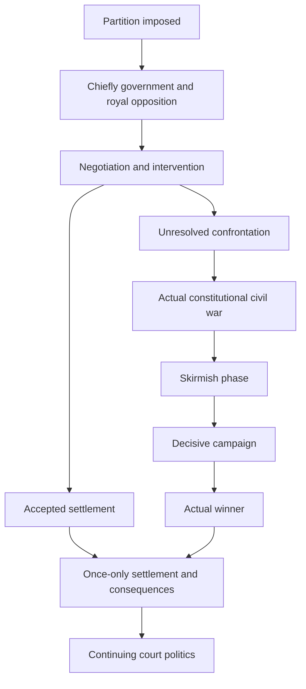

# Thirteen Chiefdoms: separate the settlement from the court

**7 November 2026 — design exploration, not an implementation instruction.**
DP is continuing playtesting and has questioned using movement activism as the
main vehicle for the partition conflict. The current baseline is SB 0.20.3,
Victoria 3 1.15.0 and CMF 1.67.2 + sb-1.15.0-r2. Preserve the accepted rebase,
existing character identities and the earlier claimant-return work.

**Follow-up:** DP selected the staged direction for further exploration. The
[expanded staged design](zulu_thirteen_chiefs_staged_design_2026_11_07.md)
develops its escalation, foreign intervention, peaceful terms and Prerogative
separation. Its numerical defaults and balance alternatives remain proposals.

## Decision register

**Current direction:** the subsequent staged mock-up was judged disproportionate.
DP now favours [refining the native movement contest](zulu_thirteen_chiefs_refinement_2026_11_07.md),
with a separate Thirteen Chiefs interface/lifecycle, payer-G bribery and temporary
protection against competing revolts. The original exploration below is preserved.

| Item | Status | Current understanding |
| --- | --- | --- |
| Separate Prerogative from Thirteen Chiefs | Provisional direction from DP | Separate the political questions and their resolution rules, not just the windows. |
| Carlist-inspired conflict | Open | Recommended below: a staged partition dispute which can become an actual war; no compulsory war immediately on partition. |
| Foreign bribery too cheap | Requested correction; tuning open | Use the actual payer's reserve capacity G. Current formula does not use it. |
| AI heir introduction / Dinuzulu missing | Birth verified; survival follow-up open | Retained 1875 save has Dinuzulu alive but unrecognised; current 1881 save lacks him. Birth, recognition and survival through annexation are separate checks. |
| Serfdom for southern African tags | Open balance/history question | Do not change laws from the general playtest note alone; connect the review to the existing BST hiring and demographic evidence. |
| Slavery and population export | Open balance/history question | Audit each tag's actual law and native slave-trade behaviour before selecting replacements. |
| Imperial Administration as a Military Bureaucrats variant | Open proposal | Separate law-family/ideology review; no change selected. |

## What the current implementation does

There are already two JEs. `je_sb_zulu_kingdom` owns the continuing court and
institutional interface; `je_sb_zululand_chiefdoms` is an international situation.
However, the latter projects ZUL's Prerogative into its main bar. Its peaceful
settlement helper requires an active institutional system, P at least 50, the
complete winning law pair, and opposing movement support below 5% or an accepted
accommodation. Institutional exit suspends interventions. Constitutional
movements can produce native revolutions; their tracked winner resolves the
contest without the peaceful conditions. It is no longer an instant restoration
at 99% Activism.

These dependencies make the foreign settlement rely on successful court
government. Modernisation, relations with the incumbent and an armed challenge
to the partition are consequently difficult to distinguish in the interface.

Sources: [institutional JE](../common/journal_entries/1-03_sb_zulu_kingdom.txt),
[partition JE](../common/journal_entries/1-14_sb_zululand_chiefdoms.txt),
[bar projection and bribery values](../common/script_values/sb_zululand_drift_values.txt),
[settlement dispatcher](../common/scripted_effects/sb_zululand_settlement_effects.txt),
[constitutional conflict tracking](../common/scripted_effects/sb_court_constitutional_war_effects.txt).

## What the Carlist example establishes

Installed Vanilla's First Carlist War JE starts around an existing war. Its
opening guerrilla modifier reduces advancement speed by 90% and combat width by
50%. Battle wins add to each side's score; the displayed bar tracks the balance.
A Royal Expedition / Flush Them Out action removes the opening restriction and
begins the decisive phase. Eligibility includes ten victories or the historical
1839 date. The eventual survivor determines completion, rather than the bar
automatically awarding the country to a faction.

The useful precedent is **preparation, skirmishing, deliberate escalation and
an actual military outcome**. It does not demonstrate a way to create a Zulu
revolution without native eligibility, or justify copying Spain's dates,
modifiers and victory counts into a much smaller country.

Local sources:
[starting war](</Users/depro/Library/Application Support/Steam/steamapps/common/Victoria 3/game/common/history/diplomatic_plays/00_carlist_war.txt>),
[JE](</Users/depro/Library/Application Support/Steam/steamapps/common/Victoria 3/game/common/journal_entries/06_the_carlist_wars.txt>),
[actions](</Users/depro/Library/Application Support/Steam/steamapps/common/Victoria 3/game/common/scripted_buttons/spain_buttons.txt>),
[battle callbacks](</Users/depro/Library/Application Support/Steam/steamapps/common/Victoria 3/game/common/on_actions/ip4_on_actions.txt>),
[modifiers](</Users/depro/Library/Application Support/Steam/steamapps/common/Victoria 3/game/common/static_modifiers/00_ip4_04_modifiers.txt>).

Historically, opposition to the appointed chiefs and disputes over territory
preceded Cetshwayo's limited restoration. That restoration did not end the
conflict; fighting continued after his death under Dinuzulu, with Boer aid and
territorial concessions. This supports distinguishing return, restoration and
durable settlement. It does not prescribe a compulsory historical outcome for
an early Klip River partition. [Cambridge, *Imperial Incarceration*, chapter 3](https://www.cambridge.org/core/books/imperial-incarceration/zulu-political-prisoners-18721897/21354AD11338C07AD5C1BF6288893297).

## Three materially different approaches

| Approach | Full course | Principal tradeoff |
| --- | --- | --- |
| A. Independent presentation, native movement struggle | Partition opens a separate movement-focused panel. NAL/TRN influence attraction and activism; a negotiated constitutional change or the actual native revolutionary winner settles it. Prerogative remains in the court. | Smallest change, but still relies on recruitment, movement demands and IG sponsorship. It does not address DP's concern about the underlying vehicle. |
| B. Partition dispute, then a Carlist-inspired war | Partition starts an unsettled political arrangement. Named houses, the claimant, territorial grievances and foreign promises drive bargaining or an explicit confrontation. An actual constitutional split opens skirmishing, followed by a decisive campaign. Negotiated acceptance or the real war result closes the dispute. | Better fit and clearer player levers, but requires an explicit escalation design and a verified transition into native war. Recommended. |
| C. Immediate armed partition | Partition creates both armed camps and starts the skirmish phase immediately. Aid, campaigns and diplomacy affect their capacity to win; a negotiated wartime settlement or the surviving side resolves the conflict. | Closest to the First Carlist War's starting state. It makes every partition an immediate war and pays the recruitment, supply and province-allocation costs before the player can attempt peaceful management. Not recommended as the default. |

Under A, institutional modernisation would no longer pause the settlement and
there would be no P threshold for its outcome. A lawful change alone should
still not claim that displaced chiefs have accepted it. Under C, the temporary
war modifiers must have cancellation and reunification cleanup; creating two
flags alone would not solve their military/economic viability. Both approaches
need a real successor if a named leader dies, not an automatic faction victory.

## Recommended B: responsibilities and flow

| Court / Prerogative | Thirteen Chiefdoms |
| --- | --- |
| Cooperation with the current ruler or council. | Survival or replacement of the imposed partition settlement. |
| Royal succession, personal pledges, popularity and institutional reach. | Named opposition, return negotiations, chiefly concessions, intervention and armed conflict. |
| Existing legitimacy and military effects where applicable. | Phase, actual participants, foreign promises and military results. |
| Remains useful after a settlement. | Ends once that settlement has an authenticated result. |

- Keep the existing named houses and commitments. Do not create thirteen new
  country tags or a second court registry. A chief's support for monarchy does
  not automatically make him personally loyal to the claimant; participation
  must reflect his actual undertaking.
- Show the named camps and their existing backing before war, not another
  equilibrium bar duplicating Prerogative. Use military results for the war's
  progress presentation. Prominence is political backing, not a claim to own a
  corresponding percentage of provinces or battalions.
- A returned claimant creates a participant and new bargaining possibilities.
  Return is not victory. A limited restoration may remain contested until its
  opponents accept the settlement or the military conflict is resolved.
- Preserve an explicit peaceful route. An accepted agreement must involve the
  relevant opposing leadership. A temporary fall in Activism is not acceptance.
  No ten-year suppression deadline or new blanket peace requirement is proposed.
- Prerogative can retain its existing effects on the government and armies; it
  neither gates the partition outcome nor declares its winner. Leaving the
  institutional JE must not erase the partition dispute. Participant and royal
  succession continuity need a bounded refresh outside the active-court gate;
  the existing institutional-exit intervention stop must also be revised.
- NAL policing addresses violence or local security; sponsorship supports the
  claimant's organisation; volunteers support an armed campaign; chief support
  strengthens named settlement backers. Each needs phase-appropriate costs and
  consequences. Preserve the existing refugee/indenture protections.
- Retain Boer Commitment and the earned NRP bargain independently of military
  progress. Neither returning the claimant nor reaching a bar endpoint grants
  territory. Retain the existing ordinary-Puppet outcomes and permanent 50%/10%
  NAL incorporation entitlements unless DP reopens them.
- One conflict controller must arbitrate both a scenario confrontation and any
  native constitutional uprising. A dynastic succession dispute is distinct;
  it must not start a second concurrent war or award partition rewards. A dead
  leader, a cancelled movement or a missing war object does not prove victory.
- Skirmishing and the decisive campaign are phases of the **same actual war**.
  A genuine victory before the campaign action becomes available still counts.
  If the engine cannot form viable sides, retain an unresolved dispute and
  offer further negotiations or a later attempt; never invent a result. Scope
  military restrictions to the belligerents and avoid importing broad Carlist
  coup/revolution immunity or penalties affecting an unrelated war unexamined.
- Preserve the original Control the Crown/direct-administration routes. Actual
  annexation closes a subject contest through its explicit annexation handling;
  no scripted annexation is a reward for winning this proposed struggle.

**Walkthrough:** Natal appoints the chiefs and later permits the former king to
return. He gathers actual backers. Natal can negotiate chiefly guarantees; the
Boers can offer aid with a recorded land promise. Accepted terms can settle the
dispute. If an organised camp rejects the terms and enters armed confrontation,
the actual split begins the skirmish phase. Successful campaigning earns the
opportunity to press a decisive offensive. A ruler can die during these stages
without dissolving his party or handing its opponent a free victory.

The escalation requirements and the campaign action are still **open design**.
The existing native war/controller work is evidence to reuse, not proof that a
new scripted button can always generate the required conflict. One-state and
multi-state allocation, food supply, staffing, both winners and foreign
intervention require DP tests before activation. Do not promise that reducing
advancement speed solves those problems, and do not replace native war with a
rolled winner if it fails.

## Independent playtest findings

**Bribery:** current cost is £5,000 multiplied by the target's individual
Prominence divided by the mean aggregated representative weight. The payer's
wealth is absent. DP has now specified payer `gold_reserves_limit` (G).
The [earlier discussion](zulu_court_balance_exploration_2026_10_19.md) considered
NAL/TRN and accepted a soft upper curve: 0.8G at 50 Prominence and 1G at 100.
Domestic pledges were subsequently retuned to 0.4G at 10, 1G at 50 and 1.6G at
100. Preserve this distinction rather than assuming the later domestic balance
settles the foreign-bribe coefficient. The earlier curve is the conservative
first candidate for this cash-funded action; the exact coefficient remains open
in this reassessment. G is a soft diminishing-returns threshold, not an absolute
cap on cash. Freeze the quote on opening and revalidate the target before
charging. Credit payment would be a separate change to its present cash-only
eligibility. Both the bribe button and acceptance currently have zero AI weight.

The current action changes **constitutional alignment**, not personal allegiance,
and can select an individual who is not the house representative. Under B,
decide whether it buys that person's camp support or a binding undertaking by
the house leader. The displayed political effect must match that selection;
replacing the price alone does not change it.

**Heirs:** the invented-son button has AI weight 1 and needs 50 Prerogative. It
deliberately excludes Mpande, Cetshwayo and Dinuzulu, whose known lines have
dated births. From 1868, monthly housekeeping creates Dinuzulu once if Cetshwayo
is a living member of the active court. This silently registers a child; it does
not appoint him heir or give a birth popup. Recognition is separate, including
AI selection. A used/dead historical template is not recreated. Inspect saved
identities across birth, recognition, exile and annexation before diagnosing
the observed absence as failed AI introduction.

The independent save inspection finds:

| Checkpoint | Observation |
| --- | --- |
| Retained 1 January 1875, `generated/playtest_1870_2026_11_07/autosave.v3` | ZUL 16777785 has Cetshwayo 4539 as ruler, no native heir and P 74.41610. Dinuzulu 67114986 is living, aged seven, registered in that court, with the politician role and career beginning 6 January 1868. |
| Latest 1 April 1881, live `autosave.v3` | Recreated ZUL 16777877 has Zibhebhu as ruler and no heir. Its restoration-claimant reference points to generated Somfula Buthelezi. Neither old royal appears in the save's global character database. |

Both saves have the same playthrough ID. These observations establish that a historical birth occurred and that these
people are absent later; they do not identify the death/removal callback or
prove why the AI had not recognised Dinuzulu by 1875. The bound-annex protection
currently saves the ruler and native heir. A living but unrecognised royal child
is therefore outside that protection even if the safeguard executes correctly.
Preserving the actual royal family through partition is a concrete remaining
task; do not recreate the deleted child through repeated birth logic. The
ongoing campaign also cannot certify that a newly edited safeguard was loaded
before its annexation.

Before an implementation plan, settle the trigger for armed escalation, the
legal/territorial meaning of a limited restoration, the bribe's political
undertaking, and Boer-offer timing around royal return versus actual succession.
Royal death and a minor heir need continuity without premature adult candidature.
An earned Boer bargain remains valid for either a qualifying negotiated or
military royal victory; fighting is not a new prerequisite for that reward.

Independent review checked the source and saves and prompted the distinctions
above. The document's local source links were checked. No engine verification
of the proposed new flow is claimed.

Sources: [bribe choice](../events/sb_zululand_settlement_events.txt),
[existing G curve](../common/script_values/sb_court_politics_values.txt),
[heir eligibility](../common/scripted_triggers/sb_court_politics_triggers.txt),
[birth controller](../common/scripted_effects/sb_court_succession_effects.txt),
[monthly caller](../common/scripted_effects/sb_court_politics_effects.txt).

Only this design record is changed by this exploration. No gameplay, dependency,
reviewed prose or save changes, and no game launch.
