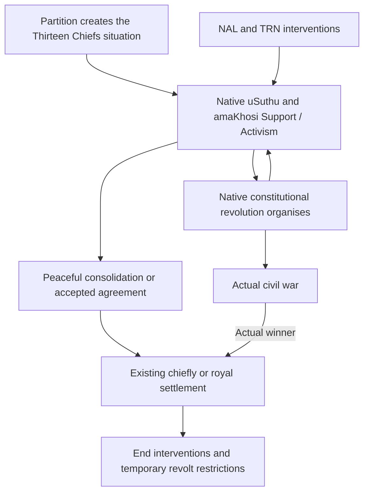

# Thirteen Chiefdoms: refine the movement contest

**7 November 2026 — design exploration only. No gameplay implementation.**

**8 November follow-up:** DP has reopened a timed settlement, requested all Zulu
houses in the international situation, and asked about 1.15's new bar presentation
and retaining amaKhosi. See the [timer and house-view exploration](zulu_thirteen_chiefs_timer_and_houses_2026_11_08.md).
Its alternatives remain proposals; the peaceful-completion discussion below is
preserved as the preceding design state.

DP found the staged proposal disproportionate to this conflict: its Disorder
duplicated much of movement Activism, while its camp backing duplicated much of
movement Support. This supersedes the direction of the
[staged design](zulu_thirteen_chiefs_staged_design_2026_11_07.md), preserving that
document and its mock-up as evidence of the alternatives considered.

## Decision register

| Item | Status | Current direction |
| --- | --- | --- |
| Refine existing mechanics | Agreed | Retain native movements; discard the proposed separate Disorder and camp-undertaking systems. |
| Separate Thirteen Chiefs from the royal household JE | Agreed direction | Give the existing international situation its own presentation and lifecycle. Exact peaceful-completion replacement remains open. |
| Presentation from the mock-up | Agreed direction | Named factions, clear measures, active interventions and visible consequences. No need for a new negotiating-party simulation. |
| Foreign bribe price uses G | Agreed requirement | Use the actual payer's maximum reserve capacity. Reusing the existing domestic price curve is provisional. |
| Suppress competing revolts during this JE | Agreed requirement | Protect the authored constitutional conflict while preserving other movements' political constituencies. Exact mode coverage and activation edge cases below. |
| Peaceful completion without P ≥50 | Open | Avoid both immediate startup victory and a new complex bargaining system. |
| Retain existing local P/IR modifiers initially | Provisional recommendation | Separate their role in settlement, not an implicit rebalance of Zulu government. |
| Further institutional/research penalties and regional rollout | Deferred | Do not fold those projects into this refinement. |

## What actually needs separating

Two journal definitions already exist:

- `je_sb_zulu_kingdom`: local court and institutions.
- `je_sb_zululand_chiefdoms`: shared NAL/ZUL/GBR/TRN situation.

However, the situation's main bar projects `(P + 100) / 2`. Its peaceful outcome
requires P ≥50 and an active institutional system. Action eligibility and the
monthly incident/commitment controller also depend on the institutional active
flag; institutional exit stops the foreign interventions. The partition's
accommodation action lives in the court JE and spends 25 P, with P also affecting
its acceptance probability.

A presentation-only extraction would retain all these hidden dependencies. It
would look clearer but would not resolve the design problem. The recommended
refinement moves the partition's lifecycle, interventions, outcome checks and
any retained accommodation action into the existing international situation.

Keep the shared character registry, actual claimant identity, native movement
definitions, ordinary political ideologies, exile handling and family succession
helpers. Do not create another set of house commitments. A foreign bribe continues
to alter the selected character's constitutional alignment. A represented
following can thereby change the existing recruitment contribution; an
unrepresented adviser does not supply that weight. Offer a chief whose change
has a meaningful represented contribution and show that actual effect, rather
than purchasing a fixed percentage of native movement Support.

Ordinary royal succession remains local. A reserved partition conflict must not
simultaneously start another SB claimant-versus-claimant conflict. Births, deaths
and claimant continuity still run where needed; hiding a court action must not
freeze the royal family or lose Dinuzulu. This continuity requires deliberate
extraction of the relevant existing helpers: the present birth/housekeeping
caller is itself inside the institutional-active branch. Likewise, recruitment
reapplication currently requires that flag. The partition must maintain its
bounded following contribution through IR exit if its bribe remains available;
merely changing the eligibility trigger would leave a paid action ineffective.

## Display native politics directly

The top of the situation should have two named faction panels:

| Panel | Show |
| --- | --- |
| Loyalist Chiefs / amaKhosi | Current chief, native Support, actual Activism, preferred constitutional pair and active assistance. |
| uSuthu | Actual claimant or representative, exile/return status, native Support, actual Activism and active assistance. |

These are separate native Support readings. Do not normalise them into a
two-party 100% share or relabel the remainder “uncommitted houses”: native Support
includes popular, military and wealth components and is not the court's pledged
Prominence calculation. A small third movement can remain politically present
without being a third participant in this settlement.

Admit the exact tracked rebel country to the situation when the war splits ZUL;
the current participant helper follows the original live-ZUL reference and does
not do this. Resolve faction readouts from the actual movement/country/war
identity during the split. A relocated movement is not a defeated or absent
opposition. Show the returning claimant's actual movement attachment rather than
assuming an agitator role alone proves it.

Below the factions:

1. **Conflict status:** no organising revolution; revolution organising; or the
   exact constitutional war in progress. Show a useful reason when the source
   permits one; do not pretend that all hidden engine eligibility is exposed.
2. **Our interventions:** actor-specific NAL/TRN controls, ongoing costs and
   their actual effect on recruitment or Activism pressure.
3. **Boer Commitment:** retain its existing territorial obligation and threshold.
4. **Settlement:** current constitutional outcome, the conditions still missing,
   and the existing aftermath. Native war victory bypasses peaceful checks.

No new Disorder counter, armed-camp Prominence threshold, skirmish score or
automatic war countdown is needed. Installed 1.15 can begin organising at 75%
Activism, subject to its other checks. Therefore 100% Activism must not be labelled
as the instant-war threshold. Show actual native organising progress once an
object exists; preserve the distinction between movement pressure, organising
progress and a successfully created rebel country.

The return arrow represents a mobilisation which subsides. Neither a stalled
revolution nor a missing movement automatically grants a victory.

## Retain the useful actions

| Action | Current mechanism to retain and expose |
| --- | --- |
| NAL policing | −20 percentage-point contribution to uSuthu's calculated Activism pressure; costs 100 Authority. Not −20 actual Activism every week. |
| NAL support for chiefs | +50% amaKhosi Pop Attraction; £500 country expense. |
| TRN sponsorship | +50% uSuthu Pop Attraction; £250 country expense; existing Commitment contribution. |
| TRN volunteers | +20 percentage-point Activism-pressure contribution; existing volunteer cost and Commitment contribution. |
| Return claimant | Return the actual living claimant and establish the intended agitator relationship. Returning him alone is not royal victory. |
| Refugee return | Preserve the 20% eligible-peasant transfer, loyalists among the remaining NAL Zulu population and the open indenture JE; retain the recruitment consequence. |
| Bribe a chief | Change the displayed eligible representative's alignment using the existing rules; recalculate their existing following contribution once. |

Attraction changes recruitment over time. The interface must distinguish the
modifier being purchased from the Support eventually gained. Preserve active
reasons in tooltips and one effect per bullet. Do not invent deterministic Support
jumps to make the preview appear more responsive.

Existing event incidents can continue to affect recruitment, mobilisation and
characters. Revise only incidents which still spend/award partition progress via
P or whose wording describes the abandoned bar. AI controls must use the same
eligibility and charges as the player; do not build an interface only humans use.

## Payer-G bribery

Current foreign price is £5,000 multiplied by the candidate's Prominence relative
to average represented weight. It does not use the payer's reserve capacity.

Recommended first implementation: reuse the established court price curve,
evaluating G in NAL or TRN, whichever is buying:

| Candidate Prominence q | Price |
| ---: | ---: |
| 10 | 0.40 G |
| 25 | 0.625 G |
| 50 | 1.00 G |
| 75 | 1.30 G |
| 100 | 1.60 G |

Clamp q to 10–100 and interpolate linearly between the existing breakpoints.
Use the existing candidate Prominence, not a newly invented house-price metric.
This deliberately reuses the already doubled domestic prices; the mock-up is not
authority to select a different curve.

Freeze the quote when the offer opens. Show the named recipient, alignment gained,
price, current reserves and resulting shortfall. Carry DP's debt-permitted payment
preference into this matching interaction; the present foreign event still has
cash-only guards, which must change on both visibility and execution. Revalidate
the actor and target before charging, but do not reopen the offer for routine
weekly price drift. Do not charge twice or purchase an already aligned target.

## Competing revolts

Recommended behaviour: while the partition is genuinely unresolved, only its
uSuthu/amaKhosi constitutional conflict may start in the actual Zulu polity and
its tracked constitutional counterpart. This does not apply to NAL, TRN, GBR,
other countries displaying the JE, or pre-/post-partition ZUL.

Keep other movements, their supporters, Activism, agitators and ordinary law
pressure. Restrict their ability to initiate a separate armed conflict. This
preserves real competition for recruitment and avoids turning their deleted
supporters into an artificial boost for the two authored parties.

The installed scripting interface exposes `revolution.possible` and
`secession.possible` on each movement type. A conditional veto there is preferable
to continually lowering Activism. The Peasant Movement is `movement_land_reform`
and has **both** routes: gating only revolution would leave an uprising path open.

No common per-movement immunity rule was found in the inspected Vanilla/CMF
contracts. Country-wide revolution immunity is unsuitable because it would also
prevent the desired war. The hard restriction therefore requires an inventory
of effective movement definitions and small conditional additions to the relevant
blocks, preserving all existing Vanilla/CMF restrictions and keeping the patch
contracts auditable. A prefix-aware scan found 48 effective movement types with
some civil-war mode across the inspected Vanilla/CMF/SB definitions; many are
disabled or foreign-specific, so this is not a claim that 48 ZUL overrides are
required. Inventory the types which can actually occur in this polity under the
pinned playset, including mod-added types. Do not promise coverage of arbitrary
third-party movements without inspection. This compatibility work is the main
cost of the hard-veto design. A soft temporary Activism penalty is less invasive
but does not provide the same guarantee or preserve actual Activism readings.

There are two materially different scopes:

- **Constitutional-only conflict, recommended from DP's request:** veto both civil
  war modes for every nonparticipant movement in the affected polity. This also
  temporarily prevents genuine minority secessions there.
- **Ideological-only restriction:** cover Peasants and other ideological causes
  in both modes, but retain identity secessions. This preserves more native unrest
  but does not guarantee that another internal conflict cannot interrupt the JE.

Use the situation's real reservation and actual-country identities, not whether
one player's visible panel happens to exist. Remove the restriction on settlement,
genuine cancellation or dissolution; an IR change does not cancel the contest.
The tracked rebel side must remain covered where it can organise another conflict.

An eligibility veto is not proof that it cancels an already organising or active
conflict. Do not delete a pre-existing war or reinterpret a peasant victory as
a chiefly/royal settlement. Implementation must inspect the activation case and
test native re-evaluation; a pre-existing active conflict remains a separate,
explicit lifecycle case. No daily global scan or repeated movement destruction.

## Peaceful resolution: the remaining substantive choice

Retain the existing outcomes: full chiefly constitution or Monarchy + Autocracy,
ordinary NAL Puppet status, permanent +50% or +10% incorporation entitlements,
and the earned NRP contract on qualifying royal success. Neither route annexes
ZUL automatically. A mixed constitution remains unresolved.

Removing P ≥50 is sensible for a truly separate contest, but it removes an
existing brake. The current condition “no opposing movement at Support ≥5%” also
passes when a movement is absent. Newly seeded movements can initially read as
weak before native recruitment has taken effect.

Two complete, small options remain:

**A — native consolidation, preferred for minimal scope.** The full constitutional
pair is in force and the actual opposing movement has become marginal (below
5%), with no exact organising/active constitutional conflict. Confirm the outcome
through the existing conclusion event and end assistance/restrictions. An
initialisation rule must distinguish genuine decline or native dissolution from
the opening recruitment interval. A six-month stability check was considered,
but is not agreed and alone does not solve the startup issue: inspected recruitment
can use annual cohorts. Requiring previous Support ≥5% is a small anti-startup
guard, but strands a movement that never becomes established. Test a native-grace-
based opening guard before selecting it; do not silently introduce a deadline.

**B — one explicit accommodation event.** Move the existing accommodation out of
the royal-household JE and make it a settlement of this contest, involving the
actual opposing leader/claimant or regent. Acceptance plus the full law pair
settles; refusal leaves native mobilisation and foreign intervention running.
This provides an exit even for a weak-never-established opposition. However, its
current 25-P charge and `50 + P/2 − actor popularity/4` acceptance formula would
also need replacement. Moving only the button would retain the coupling; removing
only the cost creates a free reroll. Named authority to consent, cost/commitment
and repeat-offer limits must be settled together. This is more design work than A,
but far smaller than the abandoned general term-sheet system.

Do not call either replacement approved. The recommended first package is A if
startup evidence supports a simple guard; otherwise bring back the bounded B
event, rather than burying a new custom progress system in the implementation.

## Prerogative balance

Keep P/IR's current governing modifiers for this first refinement. Movement
Support can still indirectly affect P through ordinary court politics; P should
not be the partition's displayed score, intervention switch or victory test.

Removing local governing effects as well would be a separate balance change:
at IR 50 and P=0, removing Courtly Politics alone gives +25 Legitimacy. Preserve
the institutional decree/reform restrictions and existing formula until that
change is deliberately chosen. Under chiefly government, royal-specific dynasty
actions remain unavailable; public partition choices belong in its situation.

## Validation and evidence limits

This turn inspected current source and installed contracts; no static suite or
engine replay was run because no gameplay changed. Before implementation can be
called complete, cover:

- all viewers reading the same native movements, Support, actual Activism and
  exact conflict; no renormalisation into a fictional two-party share;
- opening recruitment, real low-support decline, natural disbanding and a
  movement temporarily located in a rebel country;
- P/IR exit without lost claimant, births, foreign actions or false settlement;
- independent payer-G prices, frozen quotes, debt, invalid targets and receipts;
- peasant revolution **and** uprising/secession paths, newly created movements,
  pre-existing mobilisation, both tracked countries, and removal of the veto;
- full constitutional pairs, exact winner, repeated callbacks, 50%/10% rewards,
  existing territorial obligations and no unearned NRP;
- compatibility of effective movement replacements and unrelated-country
  negative controls; no global polling/performance regression.

DP performs launches and engine checks. Those checks remain pending.

## Sources inspected

- [Current international JE](../common/journal_entries/1-14_sb_zululand_chiefdoms.txt),
  [court JE](../common/journal_entries/1-03_sb_zulu_kingdom.txt),
  [projection and foreign price](../common/script_values/sb_zululand_drift_values.txt).
- [Settlement, intervention and cleanup effects](../common/scripted_effects/sb_zululand_settlement_effects.txt),
  [intervention eligibility](../common/scripted_triggers/sb_zululand_settlement_triggers.txt),
  [institution lifecycle](../common/scripted_effects/sb_institutions_effects.txt).
- [Domestic price curve](../common/script_values/sb_court_politics_values.txt),
  [foreign bribe event](../events/sb_zululand_settlement_events.txt),
  [court accommodation](../common/scripted_buttons/sb_court_buttons.txt).
- [Constitutional movements](../common/political_movements/sb_zulu_constitutional_movements.txt),
  [war handoff](../common/scripted_effects/sb_court_constitutional_war_effects.txt),
  [movement pitfalls](pitfalls/politics.md), [conflict pitfalls](pitfalls/conflicts.md).
- Installed Vanilla `common/political_movements/political_movements.md:83–99`,
  `00_ideological_movements.txt:6279,6533–6570`, and
  `common/defines/00_defines.txt:86–99,260`; installed movement/root contracts
  and source examples establish intended script eligibility, not runtime success.
- The effective Peasant definition is CMF's `REPLACE:movement_land_reform` in
  `../Community Mod Framework/common/political_movements/ycom_00_ideological_movements.txt:6608`;
  its revolution gate is at 6862 and secession gate at 6883. Preserve its CMF
  support/state-weight hooks and mode weighting. Searching only unprefixed
  definition names would miss this effective override.
