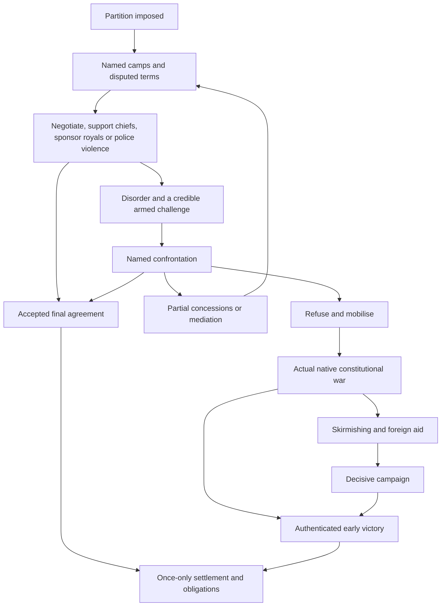

# Thirteen Chiefdoms: a staged settlement and conflict

**7 November 2026 — design exploration. No implementation authority.**

**Later direction:** after reviewing the interactive mock-up, DP chose to refine
the existing native movement contest rather than build the separate Disorder and
camp-backing systems. See the [refinement record](zulu_thirteen_chiefs_refinement_2026_11_07.md).
The proposals below are retained as historical design evidence, not current
implementation instructions.

Continues the [initial reassessment](zulu_thirteen_chiefs_reassessment_2026_11_07.md).
DP selected the staged direction for further development and clarified its
audience: primarily NAL and the Boer sponsor, currently TRN. The prospective
ZAR tag remains a separate refactor. ZUL retains meaningful choices when played.
Current source baseline: SB 0.20.3, Victoria 3 1.15.0, CMF 1.67.2 + sb-1.15.0-r2.

## Decision register

| Item | Status | Position |
| --- | --- | --- |
| Develop the staged version | Agreed exploration direction | Partition, bargaining, possible armed confrontation, then an authenticated settlement. |
| Primary audience | Agreed | NAL and TRN; Zulu faction choices remain real, rather than puppets of either foreign player. |
| Separate the partition from Prerogative | Provisional design | Its own progression, foreign actions, conflict and outcomes; no P or IR completion gate. |
| Prerogative's purposes | DP's provisional framing | Primarily royal succession; also an interface for institutional constraints. Separate the reusable calculations from Zulu history. |
| Native movement Activism | Provisional replacement | Not the displayed clock or sole test of whether partition breaks down. Native movements may remain constituencies and an engine implementation mechanism. |
| Civil-war trigger | Proposed below | Visible Disorder, an organised camp, a confrontation and actual viable belligerents. Numbers are first-pass assumptions. |
| Peaceful outcomes | Proposed below | Ratified chiefly settlement or agreed restoration. Return and an interim arrangement do not themselves finish the contest. |
| Local chiefly Prerogative | Open consequential choice | Recommend retaining its existing governing effects in the first split; monarchy-only P is a separately quantified alternative. |
| Additional research/literacy penalties and wider rollout | Deferred | The architecture should permit profiles. This design does not approve a common penalty or copy Zulu's dynasty into other countries. |
| 1.15 presentation | Proposed | Country hub for the continuing court/institutions; shared international situation for partition. |
| General serfdom, slavery, Imperial Administration notes | Deferred | Retained in the previous register; not resolved by this redesign. |
| Dinuzulu/family preservation and foreign bribe price | Open corrective work | Prior save/source findings remain; no fixes in this design turn. |

## 1. Three responsibilities, two principal interfaces

| Component | Owns | Does not decide |
| --- | --- | --- |
| Reusable institutional core | IR calculation, law profile, reform gates, existing decree restriction, independently defined future capacity challenges | Who inherits a throne or wins the partition |
| Zulu court profile | Ruler/heir, houses, personal allegiance, future succession pledges, Prerogative, historical accessions and dynastic wars | Whether NAL's partition has succeeded |
| Thirteen Chiefdoms situation | Acceptance of the imposed settlement, temporary camp undertakings, security incidents, foreign aid, constitutional war and settlement consequences | Every ordinary court succession or the country's long-term knowledge progression |

These are ownership boundaries, not three compulsory new windows. The country
hub can show Prerogative, institutional effects and links to relevant entries.
NAL/TRN use the shared partition situation. A Zulu player can open both.

Keep one character/house registry. A temporary undertaking about the partition
is distinct from personal loyalty to a ruler, a future-heir pledge and a general
constitutional ideology. A chief may accept a restored king while retaining a
preference for local chiefly autonomy. Buying that acceptance should not rewrite
all three other relationships.

## 2. Two viable escalation designs

The user-selected staged format can support either of these:

| Design | Complete flow | Strength and cost |
| --- | --- | --- |
| A. Visible Disorder plus named confrontations — recommended | Partition creates disputed arrangements. Unresolved grievances and violence raise Disorder; mediation and security reduce it. A credible camp at the crisis point makes a demand. Accepted terms settle or de-escalate; rejected demands can produce an actual war, then a negotiated or military result. | Forecastable foreign-player agency. Adds one deliberately authored measure, whose contributors must remain concrete and visible. |
| B. A sequence of concrete disputes without a meter | Partition opens disputes over land, refugees and the royal house. Decisions resolve each issue or authorise coercion. An unresolved issue with a credible armed challenger can produce an ultimatum; concessions avert war, refusal starts the armed stage. Acceptance of all binding terms or actual victory ends the dispute. | Fewer abstract numbers and strong narrative causation. Harder to forecast; repeated incidents risk feeling arbitrary, while a fixed incident sequence becomes a disguised historical railroad. |

B can work: a refugee-return dispute escalates to a boundary dispute, a chief
refuses restitution, and enforcement or mediation determines the next stage.
But the source of the next crisis must remain legible between events. A should
retain these same concrete disputes and use Disorder to expose their cumulative
effect. It should not become an automatic timer to inevitable war.



No fixed ten-year deadline is proposed. Nor does the date, a dead claimant or a
missing movement declare a winner. Continued neglect may leave an expensive,
unsettled dependency; that is a valid intermediate state.

## 3. What starts the civil war?

### Political preconditions

Start with two named camps and uncommitted houses. Count each house's existing
aggregated Prominence once through its representative. Do not treat all chiefs
as anti-royal, summon the later cast during early partition, or give descendants
independent adult constituencies. Constitutional preferences inform initial
positions; recorded undertakings govern participation.

A trial armed challenge requires:

1. A living eligible leader, or an adult representative acting for a named royal
   beneficiary. Exile alone does not erase a party; a minor is not made an adult.
2. At least **30% of total represented house Prominence** committed to the
   challenging camp; the incumbent need not pass that same political threshold.
   This is a proposed partition threshold, not the existing court succession
   threshold. Neutral houses remain in this denominator. Freeze the quoted
   participants at confrontation and revalidate them before action.
3. A plausible military constituency and territory on both sides, followed by
   confirmation of the actual native split, recruitment and supply. Prominence
   is not itself a promise of staffed battalions.
4. No other reserved Zulu civil-war episode. Unrelated external wars are not a
   blanket prohibition.

The current restoration installer selects an adult candidate. A minor/regency
outcome needs the recognised lineage and regency controller explicitly; this
proposal does not claim the current installer already handles it. Claimant
replacement and continuity must belong to this situation even while the court
is inactive.

### Visible escalation

For a first balance trial, start Disorder at **25/100**, warn at **75**, and
open the confrontation at **100** when the political preconditions hold.
These values are proposals. The UI shows the reasons and current monthly change.

| Cause or response | Illustrative effect |
| --- | --- |
| Unresolved major land/security grievance | +1/month each, at most +2 from these continuing grievances |
| Active rival volunteer mobilisation | +1/month |
| Effective NAL policing | −1/month while its actual cost is paid |
| Serious raid or broken undertaking | A visible, event-specific jump, e.g. +10 |
| Accepted compensation or settlement of an issue | Removes that issue's recurring contribution and can reduce accumulated Disorder |
| The mere existence of royalists or a different ideology | No automatic Disorder contribution |

From 25, an uninterrupted net +2 reaches 100 in 38 monthly updates; +3 in 25;
+1 in 75. These are arithmetic illustrations, not predicted campaign timings.
Resolving the causes can stop or reverse the drift. Policing can buy time but
does not earn a settlement by itself. An abuse incident can create a new
grievance; policing should not secretly add a guaranteed cancelling penalty.

At the crisis point, the named demanding camp presents its terms. NAL can offer
guarantees, compensation, restoration or support for resistance; TRN decides its
aid; local leaders decide whether the terms are acceptable. A postponed answer
or a missing foreign player is not a permanent veto. A bounded response episode
eventually returns the decision to the local parties. Successful mediation
reduces Disorder and settles specified issues; it does not simply reset every
grievance for free. Record the episode so it cannot reopen or reroll every week.

If a camp is too weak or a viable native split is unavailable, show the missing
condition and keep negotiations open. Do not award a fictitious military result.
An independently occurring native constitutional uprising is adopted by this
same controller, not followed by a second scripted conflict. Such an actual
uprising can bypass the authored ultimatum: the displayed threshold governs
this scenario's deliberate escalation, not immunity from all native revolutions.
Expose any organising native revolution alongside the warning; it must not be
the intended default clock hidden behind the new presentation.

### The armed phase

Reuse the exact-war tracking and small-country viability work, adapting it to
constitutional camps. A movement may carry the native legal demand internally;
NAL/TRN should not have to manipulate its opaque recruitment timetable. However,
source inspection has not established an unconditional native war-creation
effect: `add_civil_war_progress` requires an existing civil-war object. The
transition remains an explicit DP engine gate under 1.15.

Carlist inspiration belongs here: limited opening operations, foreign aid and
an opportunity to launch a decisive campaign. Do not copy Spain's −90%
advancement or ten-win requirement into tiny Zululand. A trial campaign action
could unlock after two actual battle wins, or after three months of sustained
preparation if the opponent will not fight. This is phase pacing, not a deadline
that awards victory. Either side can open the decisive phase; a genuine earlier
victory still counts. A stalled native war is unresolved, not automatically a
chiefly or royal success. Any later negotiated reunion must really end that war
before reunification rewards are applied.

Temporary military effects must not penalise unrelated fronts. New or inherited
state splits need viable food, civilian employment, recruitment and supply;
building levels alone are insufficient. Avoid lengthening the war merely to
show the stage if doing so recreates the famine problems already found.

## 4. NAL and TRN influence

| Actor and action | Before war | During war | Tradeoff |
| --- | --- | --- | --- |
| NAL: support loyalist chiefs | Helps named houses maintain or accept the chiefly settlement | Supplies the recorded chiefly side | Expense; no automatic personal loyalty or free universal Prominence |
| NAL: policing | Reduces violence/Disorder; does not remove royal political backing | Security/provisioning support where the exact conflict permits it | Existing Authority cost is a starting basis; coercive incidents may alienate affected houses |
| NAL: return the royal claimant | Opens direct negotiations with the actual claimant | Return must respect actual custody and belligerents | Makes a negotiated restoration possible but also gives opposition a visible organiser; return is not victory |
| NAL: refugees and restitution | Resolves a named grievance; potentially strengthens the royal constituency | Actual resettlement remains constrained by ownership and safety | Preserve the existing 20% eligible-peasant transfer, remaining-pop loyalists and open indenture JE |
| TRN: sponsor the royal party | Funds organisation and approaches to named uncommitted houses | Sustains the actual royal side | Cost and risk of worsening NAL relations; local acceptance is still required |
| TRN: volunteers | Creates documented preparation and raises Disorder | Delivers support to the actual royal belligerent | More escalation and expense; manpower cannot be deposited in the chiefly capital by default |
| Either: secure a house's undertaking | A named neutral house commits to the offered settlement | Wartime defection needs its own validated route | Payer-scaled G cost; does not purchase future-heir or personal pledges implicitly |
| Either: negotiate or withdraw aid | Changes guarantees or ends its own future expenditure | May weaken its beneficiary | Cannot revoke an already earned territorial obligation unilaterally or force all local actors to stop fighting |

Provide TRN an organisation/negotiation action from the opening stage, when
otherwise eligible. NAL withholding the claimant's return must not suppress
every Boer action. Binding royal promises require an authorised claimant or
representative. Direct national military intervention must obey the actual
play and subject rules; the current partition subject forbids initiating its
own diplomatic plays. A JE supply action is not proof that TRN can natively
join any desired side.

Bribery should use **the paying country's `gold_reserves_limit`**, not ZUL's or
a flat £5,000. As a proposal consistent with the later court price increases,
reuse the current court curve: 0.4G at 10 Prominence, 1.0G at 50, 1.6G at 100.
The earlier foreign proposal was softer: 0.8G at 50 and 1.0G at 100. Adopting
the later domestic curve here would therefore be a visible additional price
change, not merely correcting the payer scope.
For a whole-house undertaking, quote its aggregated Prominence, with the same
10–100 bounds displayed. This price unit is a proposal, not a claim about the
current individual-target action. Freeze the quote; revalidate the house and
offer. Matching the domestic credit-enabled payment policy would be an explicit
change to this action's present cash-only gate. Show reserves and the bill.

Foreign AI needs a budget and objective policy, not repeated zero-cost rolls.
Current intervention buttons mostly have zero AI weight. A proposed implementation
must make them deliberate AI choices too: maintain affordable aid, prefer terms
its beneficiary will accept and avoid buying an already committed house.

### Boer Commitment and the land bargain

Keep the existing **100 Commitment** landmark as the territorial-contract
threshold for discussion, not as another war score. Ordinary aid need not
reserve land and remains available when an existing Hamu bargain prevents a
second territorial offer. Record an authorised royal/Boer agreement before contribution
can earn the promised NRP settlement. Only actual paid or delivered assistance
earns commitment; selecting a toggle is not consent or delivery.

Current source gives +2/month for sponsorship, +3 for volunteers and an appeal
can add +20: both activities reach 100 in 20 months, or 16 after that appeal.
Those rates are inherited reference values, not a guarantee that they fit the
new stages. Peacetime organisation can count if it is a genuine paid obligation;
volunteer credit requires a real contribution. The current sole soldier-pop
check is inadequate evidence of that.

An accepted and earned bargain survives either a qualifying negotiated or
military royal victory. NAL receives the warning during negotiations. No land
passes merely because the claimant returns or a bar fills. Preserve the agreed
NRP territorial/subject contract. Reserve the land exclusively when the binding
agreement is signed, mutually excluding a competing Hamu bargain from that point,
not only after one route delivers its award. Authenticate ownership of every
promised province and complete any
actual reunion before consuming the entitlement; a third-party conquest is a
real constraint. Earlier source findings about one-anchor checks and premature
consumption are validation work, not fixes made in this turn.

## 5. Peaceful settlements

Negotiation is available before either camp can field an army. It should show
the named signatories, terms, payment and reasons for refusal. Do not repeatedly
roll the same unchanged offer. Both local camps must accept what is being
settled; NAL accepts its own guarantees and subject arrangements. TRN controls
its own bargain, not a veto over every possible settlement. Significant named
dissent cannot be silently discarded when a camp leader signs.

| Settlement | Substance | Preserved endpoint for discussion |
| --- | --- | --- |
| Ratify the chiefly settlement | Royal leadership accepts the council arrangement in exchange for concrete protection of family, property/return rights or compensation. Chiefly leadership accepts those protections. This is acquiescence, not a universal conversion to chiefly ideology. | Federated Chiefdoms + Chiefly Council; ordinary NAL Puppet; permanent +50% NAL incorporation entitlement on later-owned Zululand. No automatic annexation. |
| Agree a royal restoration | Restore the real claimant or a legitimate minor/regency; chiefly signatories accept central royal institutions with their agreed local position protected. NAL accepts the weaker incorporation reward and any valid existing Boer obligation. | Monarchy + Autocracy; ordinary NAL Puppet; permanent +10% incorporation entitlement. Honour earned NRP terms. No universal loyalty or automatic purge of the losing party. |

Returning the claimant is distinct from either settlement. An interim royal
arrangement with a Chiefly Council can also be offered, but **Monarchy + Chiefly
Council remains an unsettled compromise**, consistent with the existing design.
It may make concessions credible or leave important chiefs dissatisfied. Do not
award either terminal reward at that point.

Historical limited restoration involved an actual territorial division; merely
enacting a mixed constitution is not an exact recreation of that settlement.
Recommendation for the first staged version: use return under guarantees and
an optional interim constitutional arrangement, without manufacturing extra
country tags or claiming to have represented the full historical geography.
A literal three-territory restoration is a larger, separate design.

Peace rewards need implementation of the accepted terms, not just an opened
event. A dead signatory before acceptance triggers revalidation, not a forged
signature. Later ordinary succession does not rerun the rewards or reopen this
same contest. A new breach can have later consequences without making the
settlement forever provisional. Actual annexation or genuine dissolution of the
contest participants needs an explicit cancellation/aftermath, not a fabricated
victory. A unilateral law change, modernisation or IR exit does not cancel the
dispute; acceptance of a different political framework would need its own
defined outcome rather than silently awarding either existing reward.

This retains a NAL incentive to secure the chiefs, while letting restoration
avoid a costly war. It is not automatically better than Control the Crown:
partition entails expense, possible war and potential land concessions. Whether
the existing 50%/10% spread remains right is a playtest question, not a silent
reward rebalance in this design.

## 6. What must leave Prerogative's control

| Existing dependency | Proposed destination/change |
| --- | --- |
| Partition's main bar is `(P + 100)/2` | Replace with the situation's Disorder/phase display and named camp backing. |
| Peaceful resolution needs P ≥50, active institutions and opposition support <5% | Replace with accepted, fulfilled settlement terms. |
| Partition-only Court accommodation spends P, can renounce the claimant and directly invokes settlement | Move its action and resolving choices into ratification; no parallel unilateral peace or claim-forfeiture route through the old Court button. |
| Institutional exit stops foreign interventions | Partition owns its own eligibility and cleanup, including after modernisation. |
| NAL/TRN buttons manipulate attraction/Activism to drive the outcome | Map each action to an explicit undertaking, security response, military contribution or negotiation. |
| All matching constitutional alignments are assigned to a rebel side | Actual reserved camp commitments govern the partition split; retain unrelated personal/future pledges. |
| Court political settlement check runs inside its monthly active gate | Move outcome checks to the situation lifecycle. |
| Roster, births and claimant continuity depend on active Prerogative | Retain a bounded identity/house/head/succession service while the situation needs it. |
| Royal-aligned incumbent supporters become personal royal opposition on partition; other incumbent endorsements are cleared | Preserve meaningful displaced-ruler loyalty separately; neither conversion is automatically a binding camp undertaking. |
| Incorporation, NRP and terminal notifications | One situation dispatcher, once-only, with exact ownership and conflict receipts. |

Keep personal pledges, annual allegiance, popularity, ordinary court events,
heir recognition, dynastic rivalry, firearms/story hooks and normal mortality
in the court profile. Do not confuse the faction's political agreement with
every individual's affection for the new ruler. A royal-versus-royal war still
earns no partition reward.

## 7. Prerogative balance: a conservative split and a stricter alternative

**Recommended first pass:** retain the existing local court target and effects.
Remove its authority over the partition. Under a chiefly government show a
smaller, truthful local cooperation readout; royal succession actions remain
inapplicable. Its governing and military consequences still matter to ZUL, but
NAL/TRN need not manage that readout to complete their situation.

Current formulas:

```text
H = 100 × (incumbent-backed − rival-backed Prominence)
          / (currently pledged Prominence + 0.25 × unpledged Prominence)
C = clamp(H + ruler Popularity / 2, −100, 100)
M = 100 × (support for incumbent constitution − support for opposing constitution)
T = clamp(0.75 × C + 0.25 × M, −100, 100)
monthly drift = clamp(0.15 × (T − P), −4, 4)
```

Movement **support**, not Activism, supplies M. Keeping this background input
does not require it to drive the foreign conflict. Removing foreign support
modifiers can indirectly change late movement support; measure that rather than
claiming every late-game value stays identical. IR scales effects and controls
eligibility; it is not another target contribution.

Dropping M and renormalising C would be a substantial extra change:

| C | M | Current T | Remove M, keep 0.75C | Renormalise to C |
| ---: | ---: | ---: | ---: | ---: |
| 40 | 0 | 30 | 30 | 40 |
| −60 | 0 | −45 | −45 | −60 |
| 60 | 20 | 50 | 45 | 60 |
| 100 | 0 | 75 | 75 | 100 |

The second row crosses the existing −50 challenge threshold only after
renormalisation. Preserve the 25/50-P action requirements and costs, −50/25%
living challenge and 30% succession-pledged test unless separately reviewed.
The existing royal accession rule resets P to zero for the new reign; neither
settlement outcome grants P=50 or universal loyalty. Preserve the incumbent's
P with that incumbent if the country splits; do not copy it into a newly
installed claimant's reign. Any interim/restoration
handoff needs a once-only accession receipt so toggling laws is not a reset tool.

**Alternative: genuinely monarchy-only P.** Archive the court's royal political
state under Federated Chiefdoms and remove its signed P effects **and** the paired
Courtly Politics cost. Retain institutional reform/decree gates and necessary
identity/house continuity independently. Do not leave a permanent −25 legitimacy
cost with no means to regain cooperation.

That alternative is not balance-neutral. At IR50 the present legitimacy
contribution is `−25 + 0.5P`:

| P before change | Existing component | Removing the whole pair changes legitimacy by |
| ---: | ---: | ---: |
| −50 | −50 | +50 |
| 0 | −25 | +25 |
| 50 | 0 | 0 |
| 75 | +12.5 | −12.5 |

All deltas halve at IR25. Removing signed military/Authority effects also changes
strength, in either direction. The chiefly laws already have smaller raw
head-of-state legitimacy inputs (20 combined versus 50), government-clout
legitimacy modifiers (100 versus 120) and Authority additions (250 versus 400).
These are law inputs, not a prediction of final observed legitimacy. Select
this stricter option only as an explicit additional balance decision.

## 8. Institutions, Russia's interface and regional reuse

The useful Russia precedent is its persistent character-centred hub and linked
entries. It supports a Zulu court overview with ruler/heir portraits, actual
modifiers, visible costs and current succession or reform problems. It does not
require importing Imperial Fiat, random imperial missions or granting points
for everything. Existing Prerogative continues to mean political cooperation.

Use the 1.15 features selectively:

- Thematic JE groups and linked active entries for the country hub.
- Character widgets for ruler, heir and rival; compact effect values and actions.
- Native named outcomes to explain chiefly settlement, royal restoration and
  cancellation independently, rather than one hidden terminal outcome.
- Visible progress conditions for Disorder and action costs/cooldowns.
- Situation maps only for actual territory or occupation after a split; a
  house's political support is not a coloured province it necessarily owns.
- Scaling modifiers as a possible later simplification after proving scope,
  refresh and cleanup parity. Global JE modifiers propagate to participants:
  do not accidentally give NAL/TRN the Zulu court's bonuses or war penalties.

Institutional reform should be a reusable service/profile, not a copy of Zulu
genealogy. Swazi and Gaza can later have different royal/political content;
BST requires its own political and economic fit. The existing regional research
supports distinguishing knowledge, adoption, administrative reach and productive
capacity. It does not support treating every Society technology as five points
less royal power or all these societies as interchangeable.

For this separation, preserve current IR arithmetic and existing Social Mobility
and firearms reform gates. The broader Society/Production research penalty
remains a design question: it is not already implemented by the current IR
modifier. Changing government must not accidentally unlock a capacity gate just
because a royal UI was hidden; give those existing gates their own lifecycle.

## 9. Concrete player walkthrough

NAL imposes the chiefs. The situation shows Chiefly 45%, Royal 35%, Uncommitted
20% and two unresolved issues: resettlement and disputed chiefly authority.
These are illustrative starting values, not fixed historical allocations.

NAL pays for policing while negotiating refugee restitution. Removing an issue
reduces the ongoing escalation. TRN offers organisation support and approaches a
named uncommitted house. No one needs to inspect ZUL's native movements to see
which camp benefits.

NAL then chooses between a chiefly compact acceptable to the royal representative
and admitting the king to negotiate restoration. If the chief and claimant
accept final terms, the agreed constitution and subject relationship are applied,
interventions end and the appropriate entitlement is recorded. A valid earned
Boer promise is dealt with openly; NAL cannot conceal it by choosing peace.

Alternatively, disputed restitution and volunteers drive Disorder to a warning,
then an ultimatum. Mediation fails. The actual local camps mobilise; NAL supports
the council and TRN backs the royal party. The situation now shows real military
control and campaign readiness. The actual winning side determines the outcome,
not the old court P, an event timeout or a temporarily missing movement.

## 10. Verification and next design boundary

Before an implementation spec, DP should choose the escalation mechanism and
whether chiefly cooperation remains a local governing system. The thresholds,
drift rates and limited-campaign pacing above can be accepted as a tuning bundle
rather than separate numeric decisions. Peaceful law/subject/reward endpoints
are inherited defaults for review, not newly imposed changes.

Static and engine acceptance would cover: partition without eligible adult late
cast; exile and minor regency; independent institutional exit; unique house
weights and current-versus-future pledges; both accepted settlements; ignored and
repeated confrontations; all foreign perspectives; native conflict creation and
subject participation; both territorial layouts; food and military viability;
early wins, stalemates and third-party conquest; actual NRP delivery; no duplicate
rewards; and preserved early Dingane/Mpande/Cetshwayo balance.

Use a bounded current-participant registry, monthly situation reconciliation and
event-driven changes. Do not add daily global character or Pop scans. Broad
movement support recalculation is not the new political clock.

Independent Sol 6.1 Max review checked dependencies, balance, participant agency,
Russia/Carlist precedents and NRP edge cases. This is source/design review;
no proposed engine behaviour has been tested and no game has been launched.

## Sources and design evidence

- [Current institutional calculations](../common/script_values/sb_institutions_values.txt),
  [court calculations](../common/script_values/sb_court_politics_values.txt),
  [modifiers](../common/static_modifiers/sb_institutions_modifiers.txt),
  [lifecycle](../common/scripted_effects/sb_institutions_effects.txt).
- [Partition JE](../common/journal_entries/1-14_sb_zululand_chiefdoms.txt),
  [actions](../common/scripted_buttons/sb_zululand_chiefdoms_buttons.txt),
  [values](../common/script_values/sb_zululand_drift_values.txt),
  [settlement effects](../common/scripted_effects/sb_zululand_settlement_effects.txt),
  [constitutional wars](../common/scripted_effects/sb_court_constitutional_war_effects.txt).
- [Contested Crown's 1.15 contract review](compatibility/zulu_contested_crown_1_15_0_contract_review.md),
  [regional institutional research](institutional_reach_regional_reform_research_2026_10_30.md),
  [1.15 extension priorities](compatibility/1_15_0_extension_priorities_2026_11_07.md).
- Installed Vanilla: [Emperor and Autocrat](</Users/depro/Library/Application Support/Steam/steamapps/common/Victoria 3/game/common/journal_entries/08_tsarpoints.txt>),
  [its widgets](</Users/depro/Library/Application Support/Steam/steamapps/common/Victoria 3/game/gui/journal_entry_widgets/tsarpoints_widgets.gui>),
  [Russian Civil War](</Users/depro/Library/Application Support/Steam/steamapps/common/Victoria 3/game/common/journal_entries/08_russia_provisional_government.txt>),
  [Carlist JE](</Users/depro/Library/Application Support/Steam/steamapps/common/Victoria 3/game/common/journal_entries/06_the_carlist_wars.txt>),
  [JE interface](</Users/depro/Library/Application Support/Steam/steamapps/common/Victoria 3/game/common/journal_entries/journal_entries.md>).
- [Paradox's official release notes](https://steamcommunity.com/app/529340/announcements/)
  describe the character agendas and new journal presentation. Local definitions
  are the technical evidence used here.
- [GotB's Black Mountain](</Users/depro/Documents/Paradox Interactive/Victoria 3/mod/Example Mods/gotb - gates of the bosphorus [1.13]/common/journal_entries/7-12_eqfm_karadag.txt>)
  supplies an older foreign/frontier agency comparison; its 1.13 syntax is not a
  current API contract.
- [Cambridge, Zulu Political Prisoners, 1872–1897](https://www.cambridge.org/core/books/imperial-incarceration/zulu-political-prisoners-18721897/21354AD11338C07AD5C1BF6288893297):
  limited restoration and further conflict, supporting the distinction between
  return and settlement. The proposed mechanics and numerical values are design
  choices, not historical measurements.

Only design records are changed by this exploration. No gameplay, localisation,
dependency, save or test-baseline changes.
