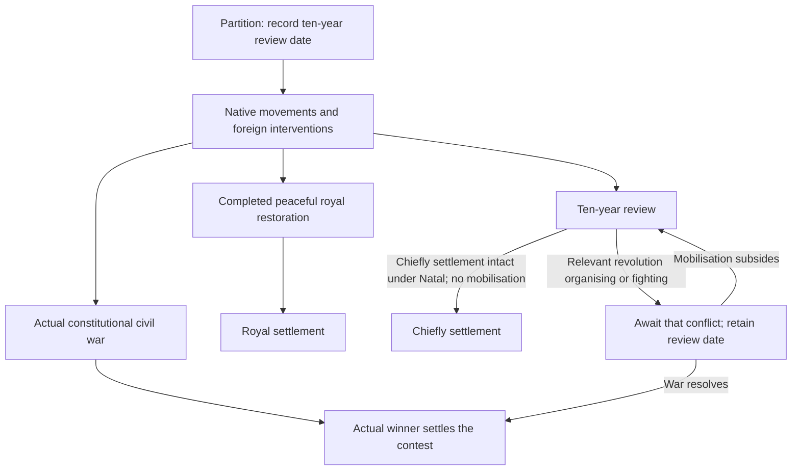

# Thirteen Chiefdoms: timed settlement and visible houses

**8 November 2026 — design exploration; no gameplay implementation.**

**9 November correction and further direction:** DP meant **100% actual Activism**,
not 100% Support. DP does not accept native civil war unless NAL and GBR can be
reliably excluded, and proposes persistent houses with nested membership views in
both JEs. The [intervention and persistent-house follow-up](zulu_thirteen_chiefs_intervention_and_houses_2026_11_09.md)
is the current discussion; the comparison below records the preceding proposals.

Continues the [movement refinement](zulu_thirteen_chiefs_refinement_2026_11_07.md).
DP has reopened a timer, suggested royalist Support reaching 100% as Natal's loss,
requested the Zulu houses in the international situation, and asked whether
amaKhosi should remain. Reopening time-based settlement does not by itself
approve the superseded instant restoration at maximum Activism.

## Decision register

| Item | Status | Direction |
| --- | --- | --- |
| Refine native movement mechanics; separate partition from the household JE | Agreed direction | Preserve the 7 November scope. No separate Disorder or camp-undertaking simulation. |
| Show all Zulu houses in the international situation | Agreed requirement | Share the existing registry and display its actual houses, leaders and members. Proposed layout below. |
| Use the new slider/bar facilities | Open presentation choice | Installed 1.15 supports custom bar art, a moving marker and visible conditional progress factors. No new player-controlled political slider was established. |
| Time-based resolution | Open, explicitly reopened by DP | Compare a fixed ten-year review with ten accumulated years of calm. Ten years is provisional tuning. |
| Royalist Support at 100% means Natal loses | Open | Recommend replacing this with actual restoration/war outcome; Support, Activism and native revolution progress differ. |
| Retain amaKhosi | Provisional recommendation | Keep the movement and Natal's constructive recruitment tools. It needs no separate victory race. |
| Payer-G bribes, competing-revolt restriction | Prior agreed requirements | Retain the scope and qualifications in the 7 November record. |
| Prerogative and IR balance | Provisional | Keep governing effects initially; remove P/IR as partition progress and outcome gates. |

## Verified precedents and limits

### The 1.15 display tools

The installed scripted-bar interface supports custom textures/colours, a sliding
marker, endpoint icons and dynamic bounds. Conditional progress entries can show
which factors currently apply. This supplies a useful presentation for existing
political values; it does not create a new contest mechanic or a drag-to-change
politics control. Paradox describes the bar customisation in
[Dev Diary 194](https://steamcommunity.com/app/529340/announcements).

Recommended use: a native **Royalist mobilisation** bar reading actual uSuthu
Activism, with its actual organising revolution shown separately when one exists.
Keep the two movements' raw Support figures in faction cards. Give the settlement
date a short status line rather than adding another large bar. Retain Boer
Commitment below the interventions.

If a two-ended amaKhosi/uSuthu visual is preferred, it could display the difference
between their raw Support values, with both absolute figures shown. This is a
derived comparison only. Do not use R/(R+C): 5% royal Support versus 0% chiefly
Support must not appear as 100% national royal backing. The simpler first pass
needs no extra balance bar.

### Springtime and Nihilism do different things

- Installed Nihilism accumulates progress in qualifying months: favourable
  Intelligentsia conditions or the specified suppression/censorship combination.
  Its goal adds 60 to its initial progress, and it has a separate 3,650-day timeout.
  Mere survival to that timeout is not the same as its suppression completion.
- Springtime's involved-country counter advances under its relevant suppression,
  low-Support and radical-leadership conditions, and resets when they fail. Its
  displayed suppression outcome uses twelve months. This is sustained control,
  rather than an unconditional date reward. The global display and country
  resolution helpers are separate; do not copy the display outcome as executable
  country logic.

These are useful structural precedents, not reasons to import their unrelated
laws, characters or exact numbers into Zulu content.

### What the percentages mean

Native Support combines popular, military and wealth support with 34/33/33
weights. Literal 100% is an extreme target in a country with multiple movements;
there is no demonstrated basis for making it uSuthu's normal victory condition.
It is not mathematically declared impossible.

Actual Activism can reach 100% with substantially less Support. Installed defines
allow organising from 75% Activism and starting at 100%, subject to the other
native requirements. Neither value alone proves that a civil war exists. An
actual organising revolution has its own progress and must produce a real split.
Earlier testing has already demonstrated stalled high-Activism cases.

## Proposal A — uphold the settlement for ten years

**Recommended for the limited refinement.** This is an endurance objective:
keep the chiefly settlement in power. It does not require eradicating royalism.

1. Successful partition records one shared review date ten years ahead. Loading,
   a late participant joining, or an institutional exit does not restart it.
2. Throughout that period NAL and TRN use the existing recruitment, mobilisation,
   refugee, claimant-return and house actions. Native movements remain the
   political mechanism; no second insurgency score is introduced.
3. An actual constitutional civil war resolves through its actual winner, even
   before the date. A properly completed peaceful royal restoration is also a
   royal result: the full royal settlement and accepted, valid royal ruler must
   actually exist. A transient law change is insufficient.
4. At the date, award the existing chiefly outcome if the chiefly constitutional
   pair still governs the relevant Zululand under Natal and no tracked
   constitutional revolution is organising or fighting.
5. A relevant mobilisation present at the review defers the verdict. Do not reset
   the date or force a winner. If mobilisation subsides and the chiefly settlement
   still qualifies, conclude then; if war starts, its outcome decides.

The organising check must follow the exact native movement/civil-war object
before the territorial split. The existing SB country flag assigned at revolution
start does not by itself detect this earlier mobilisation.

Example: partition occurs in 1880. Royalist mobilisation rises during 1886–88,
then subsides without war. If the chiefly settlement remains intact, it concludes
in 1890. If a real revolution is organising in 1890, the JE states that resolution
is pending rather than declaring victory while the rebellion is underway.

**Consequences and boundaries:**

- A popular but non-insurrectionary royal movement can survive the chiefly win.
  This is intentional endurance, not proof of unanimous consent.
- Even 99% Activism without an organising object would not alone postpone this
  version. It may mean weak mobilisation or a failed engine start; source checks
  do not reliably distinguish every such case. Meaningful early/late rebellion
  chances must be demonstrated in testing before this race can be called balanced.
- The timer cannot award a subject which Natal has lost. Current runtime-valid
  checks alone are insufficient: the existing finaliser can reassign overlordship.
  A dated peaceful award needs real relationship and ownership validation, while
  preserving authenticated civil-war handoffs.
- Mixed laws do not award either complete settlement. At review, show the missing
  constitutional condition and retain the elapsed date. If the partition polity
  or relationship has actually ended, close as interrupted without a faction
  reward; do not restore it by script to satisfy the timer.
- Check an exact constitutional conflict before interpreting the old subject's
  temporary disappearance as external invalidation. Interrupted cleanup must also
  release an unearned Chiefdoms NRP reservation: destroying the situation container
  alone currently leaves its promise flag able to block the separate Hamu offer.
- Unrelated external wars do not pause or block the date. Only the relevant
  constitutional mobilisation/conflict holds this verdict.
- A date is not a mandate for a new suppression modifier. Once the contest ends,
  its temporary restrictions and interventions end; ordinary politics can
  continue. Previously awarded incorporation entitlements are not re-awarded or
  swapped by a later unrelated revolution.

**Main risk:** passive waiting may be optimal if royalist mobilisation is too weak,
especially in early partition or without Boer involvement. AI use of Natal's
tools and actual native war formation require testing. Do not compensate for a
broken war path by interpreting maximum Activism as automatic royal victory.

## Proposal B — accumulate ten years of calm

This is a pacification objective. It draws more from Nihilism's qualifying
progress, without Springtime's punitive full reset.

1. Start at zero qualifying months when partition is established.
2. Add one month while the chiefly settlement remains under Natal, no relevant
   constitutional revolution is organising/fighting, and actual royal Activism
   is below 75%. That numerical cut-off is a **proposed** use of the native
   organising boundary, not an already agreed SB rule.
3. Pause, without subtracting accumulated months, while the royalist pressure
   condition fails. Show the exact pause reason. An actual war or completed
   peaceful restoration uses the same authentic outcomes as Proposal A.
4. At 120 qualifying months, apply the existing chiefly settlement. Invalid
   polity/relationship and mixed-law cases receive the same explicit treatment
   as A. Neither unrelated wars nor P/IR controls this clock.

In the same 1880 example, two years above the pressure threshold leave only eight
qualifying years by 1890; continued calm completes the JE around 1892.

This makes policing useful directly and gives Boer volunteers a way to delay
consolidation without winning a war. It also creates a stalling incentive: pressure
can hold the clock forever even where the movement cannot raise a viable revolt.
It needs another counter and more explanation, and it cannot promise a short
content window. Resetting all progress after every crisis would make that worse;
that variant is not recommended.

| Question | A: fixed review | B: qualifying months |
| --- | --- | --- |
| Natal's task | Keep the chiefly settlement in power | Maintain calm as well as the settlement |
| Can strong peaceful royalism survive a win? | Yes | Yes, if Activism remains below the qualifying threshold |
| Boer pressure without an actual uprising | Increases risk but does not stop time | Can pause the clock indefinitely |
| End date | Ten years, with a pending-conflict/settlement hold if needed | At least ten years; no fixed upper bound |
| Added mechanism | One review date | A qualifying-month counter and pressure condition |

A smaller hybrid would keep A's date but require Activism below 75% at review.
It changes the high-pressure endpoint without accumulating 120 samples, but it
still permits indefinite delay and rewards a last-minute dip. Treat it as a
possible refinement if DP wants pacification, not an invisible extra gate in A.

## What counts as Natal losing?

An uprising beginning and a royal victory are different outcomes. Recommended:
an uprising changes the objective from maintaining the settlement to defending
it; a royal victory or genuine peaceful restoration settles the royal outcome.

If DP instead wants *any* outbreak to fail the peace objective, record that at
the real split. It must not instantly install the king, transfer land or cancel
the war. Keep the actual conflict controller until the winner is known. Do not
introduce another reward tier for this distinction unless requested.

The existing aftermath remains the reference: ordinary Puppet relationship,
permanent NAL incorporation entitlement of +50% for the chiefs or +10% for the
royal result, and earned Boer/NRP consequences through the existing territorial
contract. Neither outcome automatically annexes ZUL. A timer is not a free grant
of missing subject status, territory or an unearned NRP promise.

## Retain amaKhosi; simplify what the player has to watch

Keep amaKhosi as the chiefly constituency, with uSuthu as the restorationist
challenge. Their roles are asymmetric while the chiefs govern. They do not need
two mirrored 100% victory bars.

- Natal's support for chiefs increases amaKhosi Attraction; policing lowers
  uSuthu Activism pressure. These are distinct constructive/coercive levers.
- Boer sponsorship recruits for uSuthu; volunteers increase mobilisation pressure.
- House constitutional alignments contribute to the existing movement recruitment
  mechanism. Exposing those houses makes this connection legible without assigning
  each house an invented fixed percentage of national Support.

Removing amaKhosi would also change neutral-character alignment, court movement
balance, chiefly law pressure, Boer-appeal comparisons and the current peaceful
royal test (which can pass when the opposing movement is absent). At 20% chiefly
Support, removing that term alone shifts the raw P target by five points away
from the chiefly settlement, before other responses and clamping. That is a wider
rebalance, not merely decluttering this JE.

Keep its native lifecycle; do not continuously recreate it to refresh enthusiasm.
If it naturally disappears, show that truthfully. Display its Activism primarily
when it is actually opposing a government, with further detail available on hover.

## Expose all actual Zulu houses

Add an expandable **Houses of Zululand** section in the international situation,
available to its involved viewers. Include royal/claimant houses, chiefly houses
and neutral houses once each; expand each row to see existing members.

| Row field | Meaning |
| --- | --- |
| House and current head | Real registry identity; clickable character; location/exile where relevant |
| Constitutional alignment | uSuthu, amaKhosi or unaligned |
| House Prominence | Existing aggregated total, counted once |
| Members | Existing named members, their roles and contributions |
| Eligibility | Whether this house qualifies for the viewing country's existing intervention |

Keep the existing bribe button and its quoted confirmation for this first pass:
it selects the most prominent eligible neutral chief. Free selection of any house
from a row would be an additional interaction change, not a consequence of merely
exposing the roster. Show the selected target's payer-G price and actual effect
in that confirmation.

Keep personal sovereign loyalty and future-successor pledges in expanded details
where useful. Neither implies constitutional allegiance. Councillors without a
represented house belong in a separate subsection, not fabricated houses; unknown
early-partition houses must not be filled with invented historical names to reach
exactly thirteen rows.

The existing member list represents eligible adult political participants, not
a complete genealogy. Minors and unaffiliated royals need not acquire an invented
following to appear in relevant character details. If a house is divided across
the original and rebel sides, show its recorded branches and contributions without
counting either contribution twice or declaring the whole house unanimously loyal.

Follow the actual partition polity, tracked rebel side and relevant exiles. A
foreign viewer must never accidentally see their own domestic court. Use bounded
registry reads and existing updates rather than daily global character scans.

Suggested hierarchy:

1. Settlement status and review date/qualifying time.
2. Chiefly and royal portraits with separate native Support figures.
3. Actual royalist Activism; exact native revolution progress when present.
4. Our interventions and Boer Commitment.
5. Houses of Zululand, expandable into leaders and members.

## Review and next design boundary

An independent Sol 6.1 Max review tested the native percentages, timer incentives,
amaKhosi dependencies and finaliser boundary. Its key cautions are incorporated:
an endurance win can leave opposition alive; an outbreak cannot award a winner;
the deadline must not recapture Natal's lost subject; and a 100%-Activism stall
requires runtime investigation, not a fabricated royal outcome.

The coherent recommendation for DP is **A + retain amaKhosi + expose the houses +
native movement/war readouts**. The substantive choice remaining is whether the
objective rewards keeping the chiefs in office or sustained pacification. No
gameplay has changed; engine verification remains pending.

## Inspected source references

- [Installed scripted-bar interface](</Users/depro/Library/Application Support/Steam/steamapps/common/Victoria 3/game/common/scripted_progress_bars/scripted_progress_bars.md:1>),
  [JE scaling and timeout interface](</Users/depro/Library/Application Support/Steam/steamapps/common/Victoria 3/game/common/journal_entries/journal_entries.md:300>).
- [Nihilism](</Users/depro/Library/Application Support/Steam/steamapps/common/Victoria 3/game/common/journal_entries/01_nihilism.txt:1>),
  [Springtime monthly counter](</Users/depro/Library/Application Support/Steam/steamapps/common/Victoria 3/game/common/journal_entries/00_peoples_springtime_je.txt:640>),
  [native Support and Activism definitions](</Users/depro/Library/Application Support/Steam/steamapps/common/Victoria 3/game/common/defines/00_defines.txt:93>).
- [Current shared JE](../common/journal_entries/1-14_sb_zululand_chiefdoms.txt),
  [current settlement and finaliser](../common/scripted_effects/sb_zululand_settlement_effects.txt),
  [current conditions](../common/scripted_triggers/sb_zululand_settlement_triggers.txt),
  [Prerogative movement contribution](../common/script_values/sb_institutions_values.txt:45),
  [house roster predicates](../common/scripted_guis/sb_court_roster.txt).

Only design documents changed. No gameplay tests or launches were performed.
