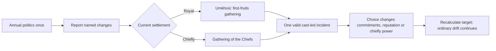
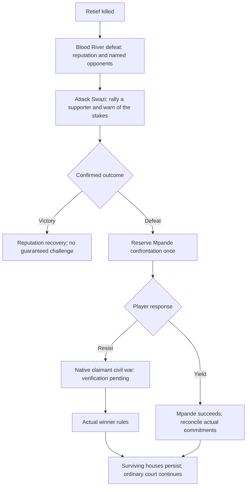

# Umkhosi, Dingane's reputation and dynastic crises

25 October 2026. Research and design supplement to the [24 October event exploration](zulu_court_event_refinement_2026_10_24.md). **No gameplay changes.** Values and the proposed guaranteed-confrontation mechanism remain provisional.

**Current status:** the [character/reputation package](zulu_character_package_proposal_2026_10_25.md) is now agreed and locked. The [consolidated event package](zulu_court_event_package_2026_10_25.md) carries forward the researched annual setting and develops the remaining event choices for agreement. The temporary reputation numbers and guaranteed confrontation recommended below are historical alternatives, not current requirements; the explicit sequence trigger remains deferred.

**Subsequent DP feedback:** permanent victory achievements replace the temporary reward proposal below. The claimant event should offer a choice of playable civil-war side, rather than yield/resist; coalition prominence should influence faction strength, with −10 P defeat shocks also explored. See the [updated rewards and war design](zulu_court_rewards_and_claimant_wars_2026_10_25.md). The historical evidence and frozen-checkpoint calculations here remain valid within their stated assumptions.

**Latest DP decision:** defer the explicit historical-sequence trigger. Playtest ordinary political changes and fixed shocks first. Recommendations below for a guaranteed sequence-triggered confrontation are retained as design history, not current implementation requirements. See the updated decision register linked above.

## Executive summary

Use **Umkhosi — The First Fruits** for the royal annual gathering. Its documented connection with chiefly attendance and royal allegiance makes it a strong setting for the agreed report of autonomous politics plus one ordinary incident [1, pp. 164–168].

Rebuild Dingane's reputation around his decisions and results. The recommended trial begins at −10 Popularity, clears the existing Usurper penalty after his first major victory, and reaches +50 after both victories. These are gameplay values, not historical measurements.

The historical defeat sequence needs an explicit design decision. Fixed numbers of newly recruited opponents do not guarantee even a sufficiently low Prerogative target, let alone a completed coup. I recommend a named Mpande confrontation after **Kill Retief → Blood River defeat → attack Swazi → defeat**, while retaining the ordinary coalition consequences. Conceding installs Mpande; resisting requires the native claimant-war route. That route remains unverified and test-only. A guaranteed challenge must not be presented as a working guaranteed civil war, or as a predetermined winner.

Generic victory → one supporter; generic defeat → one opponent is now **agreed**, following DP's clarification. Bespoke campaign consequences take precedence, with no second generic payout.

## Introduction: scope and terms

This supplement answers three questions: what historical occasion can carry the annual court event; how can Dingane's success become politically credible while the specified failures provoke a crisis; and how should the later succession use the same system without repeating his story?

“Supporter” means a court representative endorsing the current ruler, not a Loyalist Pop. A “new opponent” moves from personal neutrality to a named rival; a “defector” abandons an existing endorsement. Current allegiance, future succession pledge and constitutional alignment remain separate. House prominence follows its current representative and is counted once.

The guaranteed sequence is assessed on the requested historical line: Dingane remains sovereign, Mpande survives as an unresolved challenger, and the Zulu court system remains applicable. Killing Mpande earlier, a prior completed succession or leaving the system changes that premise; none justifies recreating a dead claimant. Numerical examples freeze the retained opening court, not an entire campaign.

## Research approach

Targeted research on 24–25 October 2026, not a systematic literature review. Searches combined publisher/DOI records, the UWA and University of Zululand repositories, EBSCO's public bibliographic record, DSAE, official South African reporting, and the Anglo-Zulu War Historical Society. Repository and publisher access was used lawfully; no paywall bypass or shadow-library copy was used.

Weir's thesis was read in full-text passages on the first-fruits ceremony; Khoza's dissertation in the passages concerning Dingane's council and the 1840 conflict; Knight's essay in its succession discussion. Okoye was available as the publisher's extract and references, and Leśniewski as an indexed abstract: their claims below stay within those limits. No claim of directly inspecting the underlying James Stuart manuscripts or Gardiner's original volume is made.

Current SB source and the retained February 1836 checkpoint supply the mechanical evidence. The calculation is a fixed-input sensitivity exercise. It does not simulate recruitment, native prominence changes, war or engine event delivery.

## Findings and evidence

### The annual occasion

**Umkhosi** is independently identified by DSAE as a first-harvest festival [2]. Weir describes the annual ceremony under Shaka and Dingane in relation to chiefly attendance, allegiance and the assembled regiments, while noting changes under Mpande [1, pp. 164–168]. This supports the setting, not an assertion that a standard annual parliamentary agenda existed.

The modern Zulu Reed Dance was reintroduced under Goodwill Zwelithini according to official reporting [3]. That does not establish that all its elements were newly invented, and the precise revival date is not needed here. The inspected evidence gives Umkhosi the clearer nineteenth-century basis for this particular design.

**Proposed presentation of the agreed B:** use a summer annual gathering, provisionally the January pulse. This is a scheduling abstraction, not an exact historical calendar claim. Resolve the existing autonomous rolls once, report named changes, and select one valid incident family followed by its participants. The ceremony does not add a recruitment roll, free allegiance or a general economic bonus.

The political business occurs around the gathering: a cattle award disputed by two houses, an appointment sought by a claimant's supporter, guns obtained through a chief, or an undertaking concerning the succession. Portraits show the actual participants. If no commitments changed, omit that report; if no valid incident exists, do not invent a quarrel to fill the slot. An open political episode must not generate another annual roll when reopened.

Under Federated Chiefdoms, use the more general **Gathering of the Chiefs** framing. The proposed UI should not imply an uncontested king presiding over a partition explicitly designed to remove that authority. This is an authored presentation variant, not a claim about an attested annual institution of the Thirteen Chiefdoms.



### Historical constraints on traits and defections

Okoye's published extract explicitly contests the hostile characterisation of Dingane that accumulated in earlier histories [4]. It is a reason to reassess the triple-negative opening package, not proof that he should instead receive a uniformly admirable personality. Office, skill, political position and a reaction to a specific deed are safer foundations than an asserted psychological diagnosis.

Do not make all important men defect merely to reach a number. Khoza places Ndlela commanding Dingane's side against Nongalaza on Mpande's side, and Dambuza acting as Dingane's envoy shortly before his execution [5, p. 59]. These relationships argue against automatically transferring Dingane's two largest external opening supporters to Mpande. Specific defections should follow plausible actors and circumstances; later commitments are not automatically opening commitments.

For the later arc, Leśniewski's abstract interprets Mpande's Klip River policy as flexible and effective, challenging a simple weak-ruler narrative [6]. Knight describes rival support around Cetshwayo and Mbuyazi, the 1856 battle, and Mpande continuing as king until 1872 [7, p. 2]. Thus the already agreed 1856 retirement is a deliberate game compression, not a historical abdication. A Klip River choice feeding a prince's future coalition is an authored causal connection, not a finding proved by these sources.

## Discussion: numerical design and alternatives

### What the opening court actually permits

The retained checkpoint has incumbent backing **206**, rival backing **75**, uncommitted prominence **424**, total **705**. Dingane's 206 is his own 100, Ndlela's 86 and Dambuza's 20. His Popularity is −75: Hedonist −15, Imperious −35, Ruthless −15 and the timed modifier labelled Usurper −10 [8]. Usurper is currently an indefinite modifier, not a personality trait.

The unchanged formula is:

```text
H = 100 × (I − R) / (I + R + 0.25U)
C = clamp(H + Q/2, −100, 100)
T = clamp(0.75C + 0.25M, −100, 100)
monthly change = clamp(0.15 × (T − P), −4, 4)
```

Holding prominence and movement balance fixed, opening Q −75 gives T −2.74; Q −10 gives T +21.64. At IR 50, eventual P +21.64 gives approximately +10.82 Legitimacy, +5.41% Authority and Training Rate, and −5.41% Morale Loss. These are equilibrium effects, not instant opening bonuses. Compared with the old target, the eventual military change is roughly six percentage points. This directly addresses DP's balance concern: the proposal does strengthen a successful/co-operative Zulu court, but adds no new offence/defence modifier. War testing should measure that effect before any additional military tuning is proposed.

The frozen checkpoint contains fourteen neutral representative weights:

```text
25, 37, 35, 32, 35, 40, 71, 31, 31, 20, 10, 47, 5, 5
```

The [calculation record](zulu_court_event_balance_calculations_2026_10_25.json) enumerates every choice of two distinct neutral supporters and four other neutral opponents, and compares it with four genuine defections. It uses final Q −90 and M 0 [9].

| Interpretation of Kill → Lose → Attack → Lose | Allocations checked | Final target T | Meets T ≤−50? |
|---|---:|---:|---|
| Two neutral recruits for Dingane; four different neutrals join rivals | 45,045 | −41.24 to −2.74 | None |
| Two neutral recruits for Dingane; then all four external supporters defect | 91 | −65.14 to −51.05 | All, in this frozen model |
| The same true defections, but M = +20 | 91 | −60.14 to −46.05 | 78 of 91 |

These are exhaustive allocations, **not outcome probabilities**: no equal-likelihood selection rule is assumed. The true-defection case requires Ndlela, Dambuza and both newly recruited supporters to betray Dingane. It is a sensitivity bound, not the historical recommendation.

Nor is T ≤−50 equivalent to a coup. From P 0, a permanent target −51 takes **27 monthly pulses** to reach P ≤−50; a target −60 takes **15**. Existing coups also require an eligible leader with strength at least 90% of resistance, clear concurrency/cooldown conditions, and successful subsequent progress. An attempt can fail or time out. Aggregate opposition also does not establish that Mpande personally owns the required coalition [9], [10].

### Three ways to honour the required defeat sequence

| Direction | Full behaviour | Strength | Consequence/limitation |
|---|---|---|---|
| **Pure political arithmetic** | Each decision recruits or alienates the specified actors, losses damage reputation, P drifts, and ordinary coup rules decide whether an attempt develops. Successful management can avert it. | Most consistent with a fully emergent court. | Does not meet DP's guarantee. Making the losses still larger cannot solve every coalition, popularity cap, delay and coup-strength condition. |
| **Recruit opposition to a threshold** | After each defeat, transfer eligible actual houses until the chosen rival has sufficient backing; then wait for P and the coup framework. Display every transferred actor and stop if no eligible pool remains. | Makes the opposition visibly organised and ties its strength to real court records. | A fixed 25% rival share does not guarantee P ≤−50. A dynamic target can demand many forced defections, misrepresent loyal actors or exhaust the eligible pool. Even then the ordinary attempt can fail. A second guarantee mechanism would still be required. |
| **Named historical confrontation — recommended** | Keep ordinary consequences; record the exact four-step sequence. On the second confirmed defeat, reserve Mpande's confrontation once. Yielding transfers sovereignty; resisting enters the verified native claimant conflict. Court backing determines the sides and their political position, rather than whether the required confrontation exists. | Meets the intended narrative constraint without falsifying a universal numerical theorem or choosing the winner. | Explicitly overrides ordinary coup entry/progression for this specific story sequence. Resisted delivery depends on the still-unverified native war mechanism. |

The third proposal is a new **explicit narrative rule**, not an invisible target clamp or a claim that −50 naturally forces it. The first defeat and the decision to attack Swazi should warn that a second defeat will bring Mpande's challenge. Purchasing a loyal chief can improve Dingane's coalition for that confrontation; it cannot silently erase the advertised trigger.



Use the actual tracked campaign result. An expired demand, transient occupation or unrelated war ending cannot complete this sequence. No blanket peace requirement is added. If the same challenge is already active, join/respect that episode rather than spawning another. If its central participants die or the premise otherwise changes, use the actual succession state; do not silently substitute or recreate a prince beneath an open popup. Other surviving claimants remain distinct.

**Feasibility boundary:** the existing coup resistance option uses weighted event outcomes; it is not a verified playable claimant war. The proposed historical confrontation must not simply reuse that roll and call it civil war. The same-constitution prototype remains test-only until DP verifies both sides and exact winner tracking. If that fails, report the specific blocker and revisit this guarantee; do not invent a foreign war or force an event-only victory.

### Dingane: a coherent first-pass reputation package

Recommended trial: replace Hedonist/Imperious/Ruthless with a restrained office/skill package, provisionally **Basic Political Operator**, and keep the opening −10 Usurper modifier. The skill is a game interpretation of political experience, not a historical personality finding. Review character-specific generation so unsupported random personality traits do not reintroduce the removed penalty stack.

| Authored reputation rule | Proposed value |
|---|---:|
| Opening contested accession | −10 Popularity, using the existing Usurper modifier |
| First verified major victory in Blood River or the Swazi campaign | Remove Usurper; +25 Popularity for ten years |
| Both victories credited to this Dingane | Replace +25 with +50 for ten years; never stack the two |
| Each outright defeat in these two campaigns | Separate −40 Popularity for ten years |

The defeat penalties are deliberately severe first-pass values. They accompany political opposition but are not claimed to guarantee a coup. A checked campaign/stalemate needs its own lesser outcome and does not inherit “outright defeat” automatically.

| Sequence, while these modifiers remain active | Resulting Popularity, without unrelated modifiers |
|---|---:|
| Opening | −10 |
| Win Blood River, win Swazi | **+50** |
| Win one, lose one, either order | **−15** |
| Lose both after the murder/attack path | **−90** |

An alternative retaining **Ruthless** starts at −25 and reaches +35 after both victories, but the source basis for that specific personality still needs justification. It offers a harsher king without the existing triple stack. The minimal package is preferred until the cast review supplies a positive reason for retaining it. No proposal should erase unrelated vanilla reputation modifiers or force a permanently positive floor after victory.

Retief's murder can still confer Wrathful and one actual supporter. Wrathful supplies Authority, **not Popularity**. Remove the automatic escalation to Cruel merely because Wrathful already exists. Honouring the bargain can confer Honourable, whose native +25 Popularity is already a meaningful reward. Retire the old direct P grants, separate +15/+10 victory reputation, automatic Brave and overlapping defeat penalties when replacing these effects. Preserve the territorial contracts, useful firearms progress and distinct military rewards unless explicitly rebalanced.

At Q −10, the existing annual personal-acknowledgement chance is 3%; at +50 it is 15%; at −90 it is zero. Thus victory also makes ordinary court politics more favourable. Constitutional recruitment remains driven by movement support. Neither system automatically pledges the next succession.

### Generic wars and the bespoke chain

Apply the agreed generic one-person result once per eligible tracked outcome. Preserve the current generic classification, including its recorded backdown handling, rather than quietly creating an additional peace or casualty threshold. Blood River, Swazi and other authored routes consume their own result and are excluded from that generic award. A white peace or mutually accepted demands need not become an invented clean victory.

Proposed default participant policy: choose a valid neutral representative for a new supporter/opponent, with an actual named rival for the latter. A specifically narrated betrayal may instead move an existing supporter, with its larger consequence shown. If no eligible neutral exists, do not manufacture one or silently upgrade “one new opponent” to a major loyalist's betrayal. That exhaustion case remains a small balance choice; no substitute Popularity reward has been approved. Preserve distinct houses and current versus future pledges.

For the bespoke losses, prefer named historically plausible movements towards Mpande, then eligible neutral representatives. Nongalaza and Sotobe are useful candidates for developed episodes, not two free opening pledges. Defections by current supporters should be tied to a concrete broken interest or undertaking. The guaranteed confrontation means these choices can remain credible rather than being distorted to hit a hidden quota.

### Mpande, Cetshwayo and Mbuyazi

Use a related but different chain. Mpande can command a functioning present coalition while his supporters disagree over the next sovereign. Ceding Klip River can cause one affected house to withdraw present co-operation and pledge an eligible Cetshwayo's future accession. A negotiated Boer arrangement can instead enhance a broker's prominence and present support while leaving that broker's future pledge unchanged. These are proposed political interpretations, not universal verdicts on his foreign policy.

Later appointments, chiefly privileges and recognition can strengthen either son's future coalition. The annual gathering gives these undertakings a visible setting. At the agreed retirement checkpoint, an unresolved major challenger causes the succession confrontation; a secured line succeeds peacefully. Do not copy Dingane's mandatory popularity collapse, use Gqugqu's opening package as proof of the sons' relative merit, or guarantee civil war regardless of a player's successfully secured succession.

The starting-trait review still covers the full authored cast listed in the earlier brief. First priorities are Dingane's reputation stack, Gqugqu's unsupported +20 from Ambitious/Imperious, Mpande's Compliant portrayal, controlled generation for the empty packages, and preventing children's later careers from becoming adult launch advantages. Evidence-based skill choices and earned event traits should precede any artificial equalisation of prince prominence.

## Limitations and evidence gaps

- The sources support political settings and relationships, not numeric Popularity or a unique personality package. Retrospective oral testimony and later historical interpretation require attribution; this brief does not promote either into certainty about private motives.
- Okoye and Leśniewski were inspected only as extract/abstract. Khoza is a later dissertation whose cited primary materials were not independently inspected; use it for the narrow relationships described here, not as uncritical authority for every date or judgement.
- The calculation holds prominence, identities, institutions and M fixed. No death, recruitment, changed trait generation, bargaining or year-to-year reputation expiry is modelled. Revised traits can alter actual prominence. Exhaustive allocations are not engine forecasts.
- No source establishes that the named four-decision chain makes a coup mathematically inevitable in every counterfactual. That is DP's authored gameplay requirement.
- Native claimant-war delivery and all new event layouts remain pending DP. There was no launch, save edit, dependency change or gameplay implementation in this exploration.

## Recommendations and decision register

| Item | Status | Current position |
|---|---|---|
| Annual report plus one ordinary cast-led incident | **agreed** | B; retain autonomous politics and one ordinary incident/year across the pool. |
| Historical setting | provisional | Umkhosi under the crown; generic chiefly gathering under partition. |
| Generic war result | **agreed** | Victory → one supporter; defeat → one opponent. |
| Historical defeat sequence provokes coup/civil war | **agreed requirement** | Guarantee the challenge on the stated historical line, not its victor. Mechanism still requires acceptance. |
| Method of guarantee | **open** | Recommend the named confrontation; arithmetic alone fails the requirement. |
| Dingane successful in both wars is positively popular | **agreed direction** | Retune opening package and remove Usurper; proposed −10/+25/+50/−40 values are provisional. |
| Evidence-based cast packages and earned traits | **agreed direction** | Exact replacements are not approved by agreement to the principle. |
| Existing routine event-family direction | **agreed direction** | Retain the previous six-template exploration; amounts and concrete scenes remain provisional. |
| Later Klip/succession development | provisional | Separate Mpande's present support from the sons' future coalitions. |
| Generic neutral-pool exhaustion | open tuning | Do not silently turn recruitment into betrayal or grant a new substitute reward. |
| Native dynastic war | **unverified** | Test-only; verify before delivering the resisted guaranteed confrontation. |
| Population Loyalists/Radicals; wider country rollout | deferred | No expansion in this event pass. |

The consequential bundle to accept is the **Umkhosi presentation, restrained opening Dingane, earned campaign reputation and explicit historical confrontation**. Exact magnitudes can be tuned together after that choice. Implementation acceptance must exercise both victories, mixed results, both losses, alternative neutral/loyalist distributions, unavailable rivals, prior crises, unanswered popups and separate generic results. It must prove that a strong surviving Dingane can win the actual confrontation and that bespoke wars never pay twice.

## References

[1] J. Weir, *Ideology and religion: the missing link in explanations for the rise and persistence of the Zulu state*, Ph.D. thesis, University of Western Australia, 2000, pp. 164–168. [DOI](https://doi.org/10.4225/23/5a375fd1c623f). Title-page year used; the repository file name contains a different year. Relevant full-text pages inspected through the institutional repository.

[2] Dictionary Unit for South African English, “Umkhosi, n.,” *Dictionary of South African English*, 2025. [Entry](https://dsae.co.za/entry/umkhosi/e07471). Accessed: 25 Oct. 2026. Lexical corroboration; later fictional quotations in the entry were not used as nineteenth-century historical evidence.

[3] B. Mncube, “40 000 maidens expected at Reed Dance,” *SAnews*, 30 Aug. 2013. [Government news report](https://www.sanews.gov.za/south-africa/40-000-maidens-expected-reed-dance). Accessed: 25 Oct. 2026. Used for the modern reintroduction, not to prove the absence of older antecedents.

[4] F. N. C. Okoye, “Dingane: A Reappraisal,” *The Journal of African History*, vol. 10, no. 2, pp. 221–235, Apr. 1969. [DOI](https://doi.org/10.1017/S002185370000949X). Publisher extract and references inspected; full article not accessed.

[5] S. H. Khoza, *The Relations Between Zulu King Cetshwayo and the British Authority at Port Natal 1872–1882*, M.A. dissertation, University of Zululand, 2021, p. 59. [Institutional full text](https://uzspace.unizulu.ac.za/server/api/core/bitstreams/ac1311f3-b85d-421b-912c-cb2a62907978/content). Printed page 59 is PDF page 61. Relevant passages inspected; retrospective synthesis, not direct inspection of its primary citations.

[6] M. Leśniewski, “The Klip River Affair in Zulu Policy, 1846–1847,” *South African Historical Journal*, vol. 75, no. 3, pp. 325–358, issue dated 2023, published online 2024. [DOI](https://doi.org/10.1080/02582473.2024.2359036). [EBSCO abstract inspected](https://openurl.ebsco.com/contentitem/gcd:181438517?crl=f&id=ebsco:gcd:181438517&jrnl=02582473&sid=ebsco:plink:crawler-gcd); full article not accessed.

[7] I. Knight, “A House Divided: The Zulu Princes Who Fought For The British in 1879,” Anglo-Zulu War Historical Society, n.d., p. 2. [Full text](https://www.anglozuluwar.com/wp-content/uploads/2020/11/AZWHS-The-Zulu-Princes-Who-Fought-For-The-British.pdf). Accessed: 25 Oct. 2026. Specialist historical essay; relevant succession discussion inspected.

[8] SB, “Zulu court: current allegiances, neutral weight and opening balance,” 24 Oct. 2026. [Local checkpoint audit](compatibility/zulu_court_allegiances_2026_10_24.md). Source/save evidence, not historical evidence.

[9] SB, “Court event balance calculations,” 25 Oct. 2026. [Inputs, enumeration results and caveats](zulu_court_event_balance_calculations_2026_10_25.json). Author's calculation. Reproduce by choosing two of fourteen neutral weights for I, four of the remaining twelve for R, applying the displayed formula, then enumerating the 91 two-recruit cases with I=100, R=181+recruits and U=424−recruits for the true-defection comparison.

[10] SB, current court source, inspected 25 Oct. 2026: [monthly coup entry](../common/scripted_effects/sb_court_politics_effects.txt), [coup candidate/progression outcome helpers](../common/scripted_effects/sb_court_coup_effects.txt), [coup JE](../common/journal_entries/sb_court_coup.txt), [effect magnitudes](../common/static_modifiers/sb_institutions_modifiers.txt), and [generic-war callbacks](../common/on_actions/sb_diplomatic_play_on_action_handlers.txt). Current source behaviour; no engine verification claimed.
