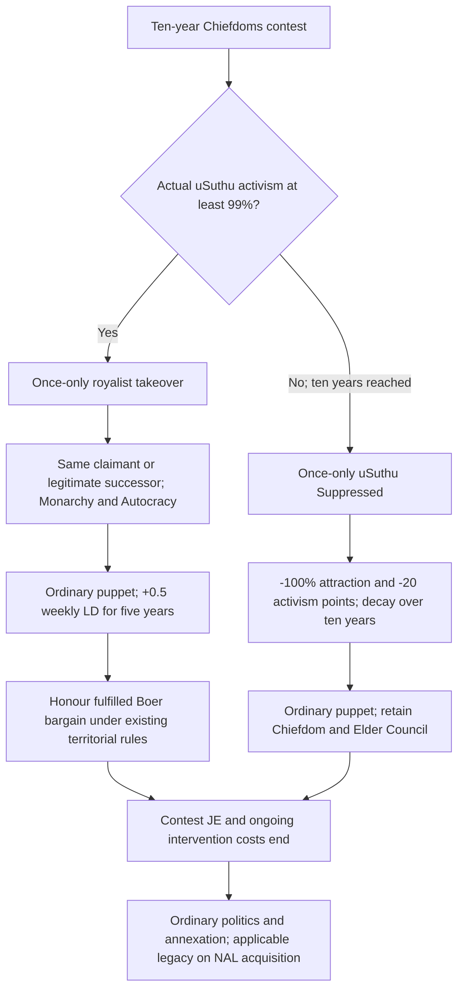
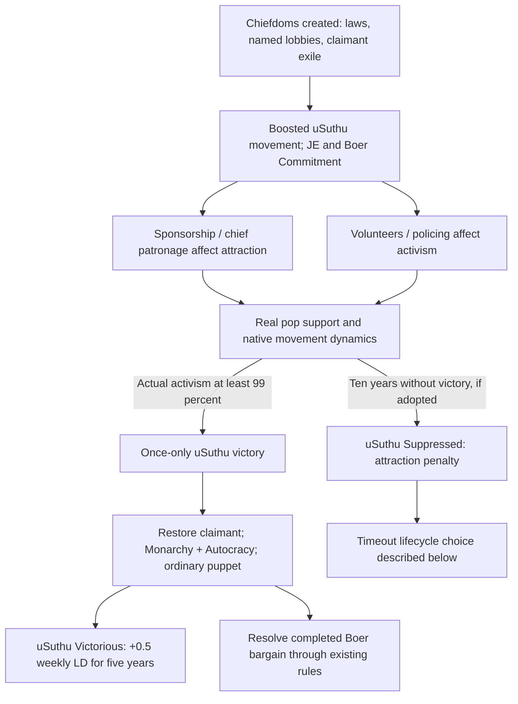
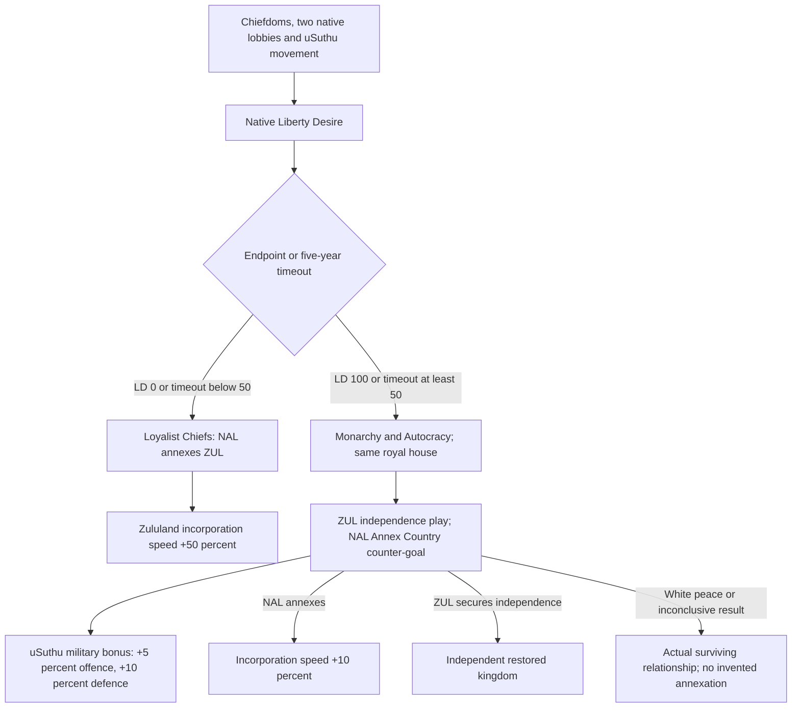
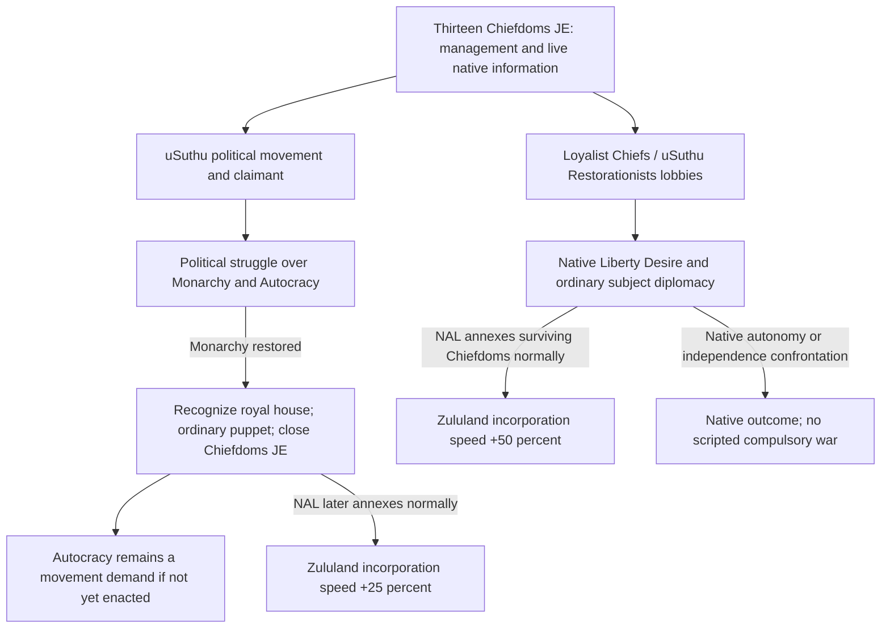
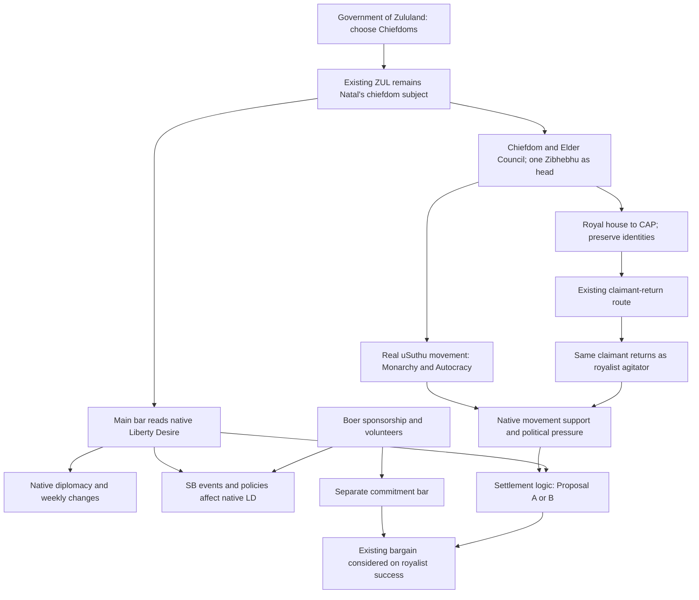
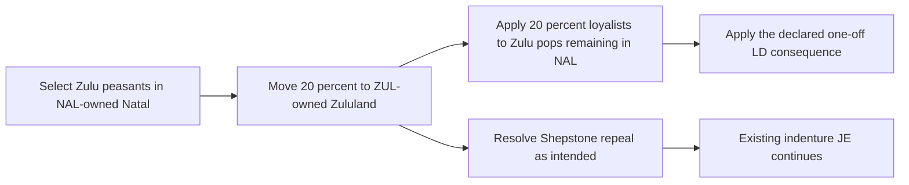
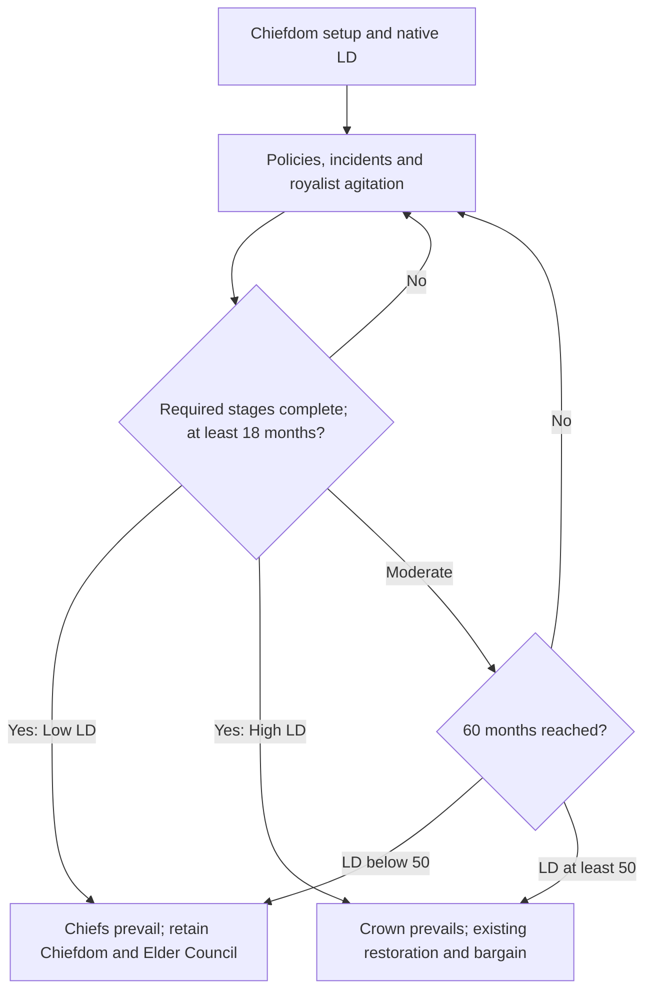
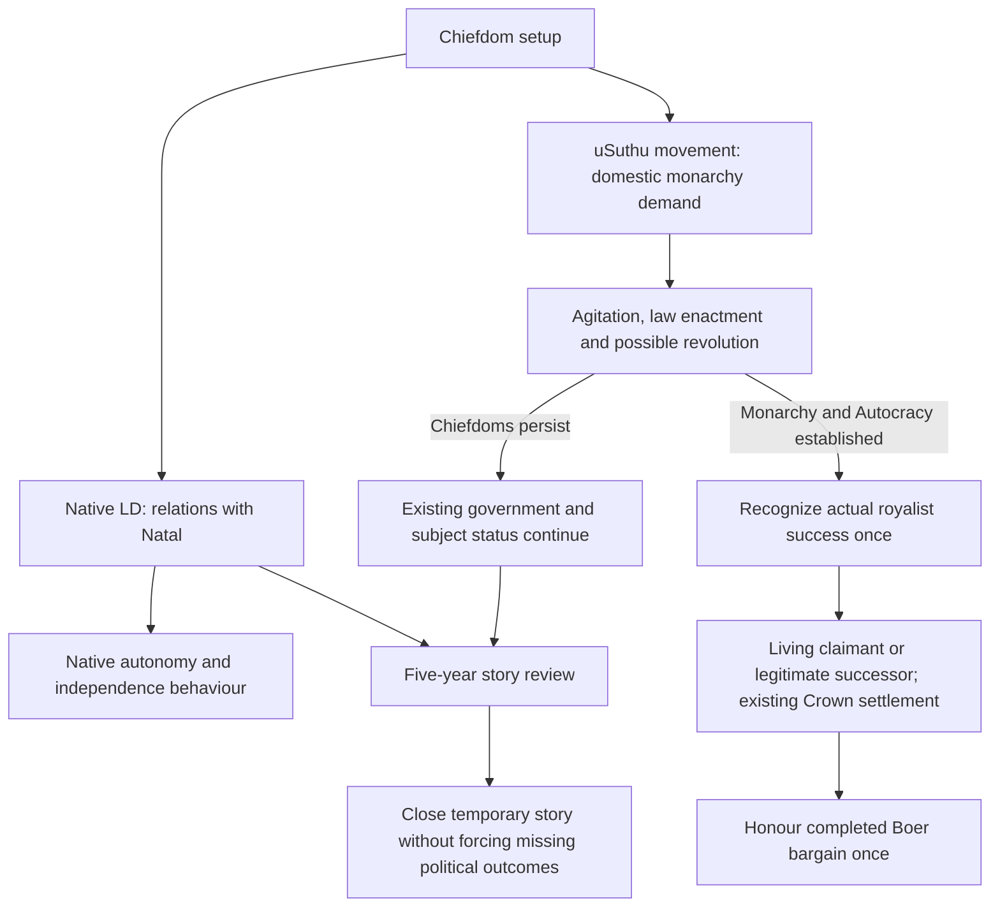

# Zululand Chiefdoms: feedback and native Liberty Desire exploration

Status: implemented with DP's final amendments; engine verification pending DP.
See [implementation report](compatibility/zululand_movement_contest_2026_09_19.md).
19 September 2026. The accepted brief below supersedes the exploratory revisions
retained after it.

## Accepted brief

DP accepted the true ten-year deadline and event-based takeover, with these final
amendments: replace Natal's hut-tax reduction action with Support Loyalist Chiefs
at a recurring £500 expense; the initial movement boost does not decay; suppression
is −100% attraction and −20 percentage points of activism, both decaying over ten
years; abandon the proposed Racial Segregation change.

### Start and interface

- Keep ZUL alive as the special puppet-category Chiefdoms subject. Apply Chiefdom
  and Elder Council, with only the necessary local law compatibility treatment.
- Use one canonical Zibhebhu; make him Petite Bourgeoisie and actually install him
  as ruler. Preserve the royal house's identities and CAP exile/return sequence.
- Establish named native pro-/anti-overlord lobbies targeting NAL: **Loyalist
  Chiefs** (Industrialists, Intelligentsia, Petite Bourgeoisie) and **uSuthu
  Restorationists** (Landowners, Armed Forces, Devout). Reuse/reconcile existing
  lobbies. Keep the genuine uSuthu movement supporting Monarchy and Autocracy.
- Give uSuthu the proposed **+50% initial attraction**, constant throughout the
  active contest. Remove this contest bonus on terminal resolution; it does not
  gradually decay while the JE is active.
- Keep the JE as NAL/TRN's management interface, displaying real movement support,
  actual activism and its 99% threshold, native LD, the ten-year deadline, and Boer
  Commitment with active contributions. No custom Authority accumulation.
- Do not change citizenship law as part of this setup.

### Actions

| Action | Effect | Cost / commitment |
|---|---|---|
| TRN sponsorship | +50% uSuthu attraction | Existing expense; +2 commitment/month |
| TRN volunteers | +20 points of calculated uSuthu activism pressure | Existing volunteer cost; +3 commitment/month |
| NAL policing | −20 points of calculated uSuthu activism pressure | Existing −100 Authority cost |
| NAL Support Loyalist Chiefs | −50% uSuthu attraction | **£500 recurring government expense** while active |

The non-user-fixed magnitudes are the accepted package's starting tuning values;
verify their operation in native calculations. They are not monthly accumulated
activism changes. No additional old sponsorship/volunteer LD effects are stacked
on them. The £500 is upkeep in the existing expense-modifier model, not an
activation charge.

Support Loyalist Chiefs replaces the separate hut-tax/payment-reduction JE lever.
Do not retain the obsolete SB hut-tax modifier or its independent drift reward.
Working interpretation: withdrawing the JE payment lever also withdraws the
earlier plan to relocate Vanilla's payment interaction into it; leave Vanilla's
ordinary interaction available rather than hide it without a replacement. This
UI interpretation is stated explicitly, not a new bespoke payment effect.

### Terminal outcomes



- The takeover event replaces uSuthu's native revolution initiation during this
  active contest only; other movements remain unchanged. No unagreed population
  support, peace, or minimum-duration gate accompanies the 99% condition.
- Apply the royalist outcome once: restore the same living claimant or legitimate
  successor, activate both laws, ordinary puppet, **uSuthu Victorious: +0.5 weekly
  native LD for five years**. No compulsory independence play or scripted annexation.
- At the true deadline without victory, remove the initial boost and apply
  **−100% attraction** and **−20 activism points**, each **decaying over ten years**.
  These are native modifiers, not deletion of supporters or a guarantee that all
  other attraction modifiers sum to zero. Preserve the movement itself.
- Suppression closes the JE and normalizes the subject to ordinary puppet while
  retaining Chiefdom/Elder Council. End intervention expenses and the scripted
  commitment contest; no NRP award for an unfulfilled royalist victory. Restore
  native political behaviour outside the finished contest.
- Victory takes precedence if its qualifying outcome coincides with the deadline.
  A pending/open terminal event cannot coexist with another terminal resolution.
  Neither holding the popup nor the monthly pulse can repeat outcomes.
- NAL annexation remains ordinary gameplay: **+50% incorporation speed** after the
  chiefs' settlement, **+25% after restoration**, only on actual relevant land
  acquisition and never stacked. Retain the existing 120-month legacy duration as
  the baseline. A real later restoration updates which legacy applies.

### Retained corrections and validation limits

All original feedback remains covered: missing concept explanation; one properly
installed Zibhebhu; refugee movement of 20% of eligible Zulu peasants followed by
the 20% loyalist effect on remaining Natal Zulu pops; continued existing indenture;
active commitment breakdown; hide scheduling with **unchanged event delays**;
replace obsolete hut-tax effects; align incident previews with their actual
movement/native effects; explain NAL/TRN influence in the JE; **leave reserves
unchanged**; requested laws, lobbies, claimant and movement setup; native LD only.

Engine checks remain necessary for marginal lobby survival, actual agitator
membership, law persistence and ruler identity, modifier pressure versus current
activism, same-tick 99%/revolution/timeout handling, decaying modifiers, ordinary
subject controls, and annexation/NRP territorial identity. No fallback narrative,
save migration, blanket peace gate, or unrelated political override is authorized.
DP performs all launches and engine verification. The accepted brief is now implemented; historical discussion below retains its original status wording.

---

The following sections preserve the design discussion; conflicting proposals are
superseded by the accepted brief above.

## Current revision: movement activism and a ten-year contest

This latest section takes precedence over the earlier revisions below. DP accepts
the JE as NAL/TRN's interface and now proposes a scripted royalist victory at
**99% native movement activism**, rather than victory from LD or requiring ordinary
law enactment. DP's completed final sentence also requests an initial boost for
the absolutist/uSuthu movement. No implementation has begun.

| Item | Current design state | Status |
|---|---|---|
| Main mechanism | NAL/TRN interventions affect the real uSuthu movement. Lobbies and native LD remain the wider political/subject context. | agreed |
| TRN sponsorship | Increases movement pop attraction. | agreed; magnitude provisional |
| TRN volunteers | Increases movement activism. | agreed; magnitude provisional |
| NAL policing | Reduces movement activism. This reintroduces policing with a different effect, superseding its earlier removal. | agreed direction |
| NAL attraction action | Recommend **Support Loyalist Chiefs**: recurring financial patronage reduces uSuthu attraction. | provisional |
| Initial movement boost | Explicit initial pop-attraction bonus, separate from sponsorship and citizenship law. | boost agreed; form/tuning provisional |
| Activism >=99% | One event restores the claimant, activates Monarchy and Autocracy, normalizes to puppet, grants “uSuthu Victorious.” | agreed direction |
| Victory modifier | +0.5 native LD contribution for five years. Interpret as +0.5/week, the native modifier unit; not an autonomy-level change. | magnitude/duration agreed; unit interpretation explicit |
| Ten-year timeout | Suppression event and reduced attraction, rather than an LD-based verdict. | provisional: DP supplied a question mark |
| Boer Commitment | Retain the real commitment bar and active factor breakdown. | agreed |
| Racial Segregation | Possible setup law; Vanilla absolutists are neutral toward it. It does not substitute for an initial movement boost. | provisional |
| Earlier corrections | Sequencing hidden with timing unchanged; native payment pact through JE; reserves unchanged; refugee/indenture/character corrections retained. | agreed |

### Working action package

Provisional numbers make the proposal inspectable; none is a separate approval
gate. Keep movement effects local to uSuthu, not every Zulu political movement.

| Actor/action | Movement effect while applicable | Cost/other effect |
|---|---|---|
| Chiefdoms setup: Royalist Networks | +50% pop attraction during the contest | Initial advantage; not +50 percentage points of population support |
| TRN: Sponsor uSuthu | +50% pop attraction | Retain existing sponsorship expense and +2 monthly commitment |
| TRN: Send Volunteers | +20 percentage points to calculated activism pressure | Retain existing volunteer cost and +3 monthly commitment |
| NAL: Police Royalist Organizing | −20 points to calculated activism pressure | Retain existing −100 Authority cost |
| NAL: Support Loyalist Chiefs | −50% uSuthu pop attraction | Provisional recurring expense matching sponsorship's current 250 expense modifier |
| NAL: Reduce Subject Payments | Native −0.05 weekly LD and native payment reduction | Keep this financial interaction's native effects; no duplicate SB activism reward |

Native activism has a current value and calculated pressures toward which it
changes. `political_movement_radicalism_add` and
`political_movement_activism_growth_mult` are distinct supported modifiers; the
latter accelerates growth and is not a guaranteed additive increase. Implement
the intended opposing activism pressures through the former after verifying the
engine calculation. Do not describe +20 as a monthly cumulative increase or a
direct write to current activism. The actual current value drives the 99% check.

Keep the agreed native LD display and Boer Commitment bar. Add a prominent live
uSuthu movement readout showing actual activism, the 99% threshold, actual popular
support, and links to both breakdowns. These are distinct quantities; do not label
LD or commitment as restoration progress. The JE also shows time remaining to a
real deadline, or the date of a one-off review if the continuing variant is chosen.

Funding Loyalist Chiefs is preferred over another new land-reserve bonus: it
directly answers the missing attraction lever without reopening DP's closed
reserve issue. A concessions alternative could also reduce attraction, but would
overlap with the existing payment/refugee decisions or require specifying new
material concessions. Do not add extra national laws as an unexplained price.

The old sponsorship/volunteer direct-LD contributions are replaced by these
movement effects. Native lobby effects remain. The earlier +0.1/month claimant
return LD contribution is retained provisionally as a separately agreed effect;
its identity/agitator influence also operates through native movement mechanics.
Do not turn every old Authority factor, including bureaucracy, automatically into
a new movement modifier. Bureaucracy's special LD term is now an open retention
question; recommend dropping it with the obsolete score model to keep direct
interventions legible. Native economic and diplomatic effects remain untouched.

### Victory, observation, and once-only resolution



At victory, restore the same living claimant or the established legitimate
successor, not a random generated ruler. Apply both requested laws explicitly;
this supersedes the prior proposal to wait for ordinary enactment. Keep NAL as
overlord and puppet-category autonomy. The temporary victory modifier raises LD,
not subject autonomy status. The +0.5/week raw contribution is strong over five
years, though native scaling means it does not add a guaranteed 130 final points.

Use one terminal resolution reservation. A victory pending or opened must not
also receive a timeout event. At the common deadline, a qualifying victory wins
precedence over suppression. Separate opening a notification from applying its
effects so holding a popup open cannot produce another terminal event. Resolve
the institutional effects once at the chosen resolution boundary and make the
event describe their actual result. Do not arbitrarily force unrelated peace.

Native revolution organization can start at 75% activism; the installed threshold
for civil-war start is 100%. A 99% event must therefore be tested against jumps to
100 and an already-organizing insurrection. A monthly check plus delayed popup is
not proof of safe ordering. For a guaranteed event-based takeover, recommend a
**uSuthu-only exception to native revolution initiation during the active contest**,
using a local movement definition; other movements and native independence politics
remain unchanged. This is a proposed rule, not an assumed technical restriction.
The alternative is to let native revolution take precedence if it starts first,
then reconcile its actual result; this preserves native revolutions but cannot
guarantee the requested peaceful threshold event. The choice belongs in the
accepted package, not a hidden implementation workaround.

High activism is not high popular support. The proposed rule intentionally allows
a small but militant movement to trigger restoration. Record this tradeoff; do
not add an unagreed support, peace, or minimum-duration gate. The starting boost
helps the movement attract supporters but does not logically eliminate this case.

If ordinary political change restores the Crown before 99%, reconcile it once
instead of leaving an already-satisfied restoration contest running. Any reward
or Boer entitlement must be tied to that actual accepted outcome, not to a later
phantom second restoration. Annexation or loss of the relevant country ends its
obsolete contest and ongoing costs without fabricating a winner.

### Two complete realizations of the ten-year ending

**A — a real contest deadline (recommended).** Ten years after creation, absent
royalist victory, fire uSuthu Suppressed once. Remove the initial attraction boost
and apply a provisional −50% movement attraction modifier for five years. End
sponsorship/volunteer/policing/patronage costs and the commitment contest, without
granting NRP for an unfulfilled royalist victory. Keep the real movement alive;
do not erase its supporters or permanently ban native political change.

Close the contest JE and convert surviving Chiefdoms to an ordinary puppet while
retaining Chiefdom and Elder Council. This is normalization, not annexation or a
change of autonomy category. Restore ordinary subject-interaction controls and
retain any valid payment pact. Record the Loyalist Chiefs legacy for +50%
incorporation speed if NAL later annexes. If an actual later Crown restoration
occurs, record the restored legacy instead (+25%); never stack both. Outside the
finished contest, remove the special 99% takeover and any contest-specific
revolution exception: subsequent politics are native. This makes ten years a real
deadline for the scripted bargain, not a permanent prohibition on royalism.

Example: TRN funds the movement but NAL contains activism below 99 for ten years.
The appointed chiefs remain in government and become a normal puppet; uSuthu
loses momentum, the JE closes, and NAL uses normal annexation mechanics. This
preserves management access after the JE ends but changes the special subject
type even without monarchy. That normalization needs DP's acceptance.

**B — a ten-year setback, with continuing management.** Keep the special Chiefdoms
type and JE. At year ten, fire the same suppression setback once, remove the
initial boost, and reduce attraction for five years. Keep influence actions,
commitment, and the 99% restoration route active. TRN can continue supporting
a recovery; NAL must keep managing it. There is no repeatable ten-year suppression
reward and no automatic annexation. This preserves the special arrangement but
is a milestone, not a true JE timeout. It can continue indefinitely and makes
long-term funding/commitment more valuable. Do not call this a completed contest
while continuing to offer all its victory routes.

Neither realization leaves the special type without its only payment interface,
deletes the movement merely to declare it suppressed, or grants annexation because
a timer expired. Proposed suppression tuning is a temporary attraction reduction,
not instant removal of half the supporters.

### Citizenship and initial boost

Racial Segregation remains a proposed setup choice, not an agreed fix. In the
installed game it governs acceptance relative to **ZUL's** primary cultures;
it does not implement Natal's white-over-Zulu hierarchy inside a Zulu-primary
country. Vanilla's absolutist ideology is neutral toward Racial Segregation, so
the law is not a direct ideological recruitment bonus. Give uSuthu the explicit
Royalist Networks attraction boost regardless of this law decision. Preserve
citizenship at restoration unless DP separately chooses a replacement; restoring
Monarchy/Autocracy does not imply another citizenship-law change.

The next substantive acceptance bundle is: movement actions and initial boost,
99% event-based restoration, treatment of competing native revolution, and either
the real deadline A or continuing-management B. Numeric tuning remains provisional.
All launches and engine checks stay with DP. No runtime changes or gameplay test
claims accompany this design revision.

## Revision after DP's lobby and native-settlement feedback

This section is the current decision record. The initial exploration below is
retained as history; this revision supersedes its conflicting proposals. No
gameplay changes are authorized merely by recording the design.

### Accepted corrections and remaining interpretation

| Item | Current direction | Status |
|---|---|---|
| 5 | Hide internal event sequencing. Preserve the existing delays; do not adopt the proposed pacing changes. | agreed |
| 6 | Put Reduce Subject Payments in the JE for the Chiefdoms relationship, removing its ordinary interaction entry there. Reuse the native pact and its native LD drift; remove SB's alternative payment modifier and associated duplicate authority/LD reward. | agreed |
| 10 | No reserve change. DP identified the tsunami modifier as the reason the existing benefit looked weak. | agreed; closed |
| 13: lobbies | Create/reconcile Loyalist Chiefs versus uSuthu Restorationists on Chiefdoms creation, targeting NAL through native pro-/anti-overlord lobby types. | agreed |
| Lobby membership | Restorationists: Landowners (the IG corresponding to the requested aristocratic bloc), Armed Forces, Devout. Loyalist Chiefs: Industrialists, Intelligentsia, Petite Bourgeoisie. Set the single Zibhebhu to Petite Bourgeoisie. | agreed; mapping explicit |
| Claimant drift | Weaken 0.5 to 0.1. Read this as per month, matching the current 0.5/month source; about +0.023/week before native scaling if implemented as a weekly modifier. Do not accidentally make it +0.1/week. | magnitude agreed; unit interpretation provisional |
| Side naming | Use “Loyalist Chiefs” for the side, independent of whether Zibhebhu is still alive. | agreed |
| Settlement | DP first proposed an LD endpoint/timeout confrontation, then considered replacing that with native political change and ordinary annexation. Both flows are developed below; the latter is the recommendation. | open; latest preference favours native settlement |
| Incorporation under latest variant | NAL annexing continuing Chiefdoms earns +50%; annexing the restored kingdom earns +25%. Interpret as state incorporation speed, matching existing modifier implementation. | conditional on final variant; units explicit |
| JE future | Retain it as the management interface while the Chiefdoms arrangement exists. Remove forced resolution, not the interface, in the native-settlement variant. | recommendation |

All earlier agreed corrections remain in scope, including refugee 20%/20%,
indenture continuation, one Zibhebhu, concept text, active commitment breakdown,
requested laws and movement, and removal of colonial policing. The previous
reserve increase and changed incident delays are withdrawn.

### Why the lobby proposal fits Vanilla

Installed `liberty_desire_weekly_change` explicitly checks the exact lobby types
`lobby_pro_overlord` and `lobby_anti_overlord`. For member IGs, it subtracts or adds
their clout divided by two in government, divided by four in opposition. Thus,
before other scaling, an IG with 20% clout contributes 0.10/week in government or
0.05/week in opposition, negative for the loyalists and positive for restorationists.
These are existing native contributions: do not add an SB copy on top.

Retain those exact types and provide names for the ZUL instances. Making two new
lobby type IDs merely in the same categories would miss the native type-specific
calculation. Vanilla has customizable pro-/anti-overlord names, and examples for
creating a lobby with several IGs or adding IGs to an existing lobby. Reconcile
existing NAL-targeted memberships instead of creating duplicate lobbies or allowing
the same IG to belong to both opposing NAL blocs. Leave unrelated foreign-target
lobbies alone. The lobby setup is an initial political alignment, not an invisible
monthly command forcing each IG back forever; durable membership beyond native
behaviour would be another design decision.

The relationship is a tendency, not identity: native economy, relations, power,
and other pressures still affect LD. An opposition IG contributes half as much,
not zero. The proposed uSuthu political movement remains necessary to demand
Monarchy and Autocracy; an anti-overlord lobby by itself does not enact those laws.

One feasibility issue needs engine testing: Vanilla disbands a lobby if all its
members are marginal. Industrialists/Intelligentsia/Petite Bourgeoisie may be weak
in early ZUL. Do not silently increase their clout or force them into government
to make the diagram work. If both named blocs must persist even then, a narrowly
scoped maintenance exception needs explicit inclusion in implementation design.
The default proposal retains native political strength and lifecycle.

### Payment control: one native financial relationship

The JE button creates the same `decrease_payments` pact used by the Vanilla
interaction: −0.10 income transfer against the Chiefdoms' 0.30 base, with native
`country_liberty_desire_add = -0.05` on the subject. That produces a 0.20 base
transfer before other adjustments. Retain the pact's 12-month forced duration,
mutual exclusion with Raise Payments, and native +10 LD manual-cancellation
effect. Display the actual final weekly change in the native breakdown.

The Chiefdoms JE must also expose the current policy and permitted cancellation;
moving initiation alone would strand the player. Keep the underlying pact valid
when hiding the ordinary interaction. Do not make a visibility condition that
also prevents the JE from creating or maintaining it. Ensure AI Natal has the
equivalent decision path. Existing `.111` choices must use/reconcile the same pact
without stacking a second reward, bypassing cancellation restrictions, or creating
a second payment system. No replacement scheduling prose is required.

On transition to an ordinary puppet, restore the ordinary interaction and retain
the existing pact if still valid; do not remove/recreate it and reset its duration.
If the Chiefdoms JE becomes unavailable due to a changed overlord or another
terminal state, the UI restriction must not leave a valid surviving pact without
controls. This is an interface-lifecycle requirement, not a new gameplay gate.

### Variant A: lobby-influenced LD contest with scripted confrontation

This is DP's first ending proposal in the feedback, retained for comparison.
No 18-month minimum. LD 0 resolves for Loyalist Chiefs; LD 100 resolves for uSuthu.
If neither endpoint is reached, the existing five-year timeout resolves for
uSuthu at LD >= 50, otherwise Loyalist Chiefs. Native endpoint scaling makes exact
100/0 slow through drift, although one-off changes may reach them; do not silently
substitute the 25/75 bands from the initial exploration.



The independence play cannot be assumed to launch in every conceivable diplomatic
state. Preserve a pending real confrontation if temporarily unavailable; never
declare victory or auto-annex because creation failed. Tie outcomes to that exact
play and actual territorial/subject results, including backdown and timer order.
White peace leaves whatever native relationship survives. The proposed combat
bonus lasts only through the relevant struggle, does not stack, and is removed
when it ends. Do not grant NAL incorporation credit before annexation actually
occurs. A fulfilled Boer bargain can qualify for NRP through the existing lawful
territorial route; commitment alone is not a reason to fabricate ownership.

Example: loyalist IGs dominate and LD reaches zero in month 12; NAL annexes then,
without waiting 18 months. Alternatively LD remains 55 until the timeout: the
story installs the Crown and starts independence even if movement support is weak.
This gives a decisive narrative but forcibly couples a constitution and war to
LD. It also automatically annexes loyal Chiefdoms irrespective of ordinary
annexation permission. That is the central tradeoff with the latest suggestion.

### Variant B: keep the JE, let politics and diplomacy resolve the arrangement

Recommend this as the interpretation of DP's final paragraph. The JE remains
active while the Chiefdoms arrangement exists. It presents LD, both lobbies, the
uSuthu movement, the current Boer commitment, and management actions. It has no
forced LD winner, no five-year constitutional verdict, and no 18-month minimum.
Do not auto-close it at five years while withholding the ordinary payment control.



Propose **ordinary puppet** as the normal subject type: it preserves the custom
Chiefdoms' current puppet-category autonomy, and the existing Chiefdoms terminal
helpers already use it. Choosing protectorate would additionally grant autonomy,
not merely normalize the special type; that is not inferred from restoring a
monarchy. Initial Government of Zululand's separate protectorate option remains
separate and unchanged.

DP's latest wording says “if the monarchy is restored.” Accordingly, Monarchy is
the proposed recognition/normalization trigger; do not retain the initial brief's
extra gate requiring Autocracy first. The movement supports both laws, but if
Monarchy is established with Elder Council still in force, the subject becomes
ordinary and uSuthu can continue demanding Autocracy. Do not silently legislate
Autocracy merely to make a final event match its expected text. Reuse the living
claimant as ruler and remove the agitator role; handle the established legitimate
successor if the claimant has died. A republic or other unforeseen native outcome
must retain its actual government rather than being relabelled royalist success.

When a native revolution changes political tags, identify the actual continuity
of ZUL/the winning polity before awarding restoration, any Boer bargain, or
annexation bonuses. A lost war or changed owner is not a reason to recreate a
deleted kingdom. No new automatic peace or war-ending effects are implied.

Example: native LD is only 30, but the returned claimant wins enough political
support to restore Monarchy. ZUL becomes an ordinary puppet, still under Natal,
and no war is forced. The movement may subsequently achieve Autocracy. Conversely,
at LD 90 with weak royalist politics, the chiefs remain in charge and can face
ordinary autonomy/independence politics. Natal's ability to annex remains whatever
the game's ordinary rules permit, including its own colonial-subject constraints;
this design grants no special permission to bypass them.

The earlier +10% post-war incorporation proposal is replaced by the latest +25%
restored-kingdom case in B. Interpret +50%/+25% as **incorporation speed**, not an
immediate progress injection, following existing `state_incorporation_speed_mult`.
Keep the existing 120-month duration provisionally; no new duration was requested.
Award only after actual NAL acquisition of the relevant Zululand territory, once,
from the recorded pre-annexation arrangement. Partial/timer territorial transfers
and split-state merging must not count retaining Natal's pre-existing land as a
fresh annexation or award the bonus twice. Do not stack both legacies. Ordinary
incorporation costs and initiation remain ordinary player/AI decisions.

Boer aid can remain meaningful through native LD, movement attraction, and the
existing commitment bargain. On genuine royalist success, honour a completed
bargain once through its existing territorial rules; peaceful restoration alone
does not cancel promised aid. No NRP is created merely because LD is high. With
no actual war, do not apply the proposed uSuthu combat bonus. If retained for a
real uSuthu struggle, restrict its +5% offence/+10% defence to that actual conflict
and remove it afterwards. This conditional military bonus is provisional, since
DP introduced it in the earlier forced-war variant.

After normalization, keep genuine lobbies, political movement, and valid native
pacts. Remove obsolete Chiefdom-only drift and management controls; do not reset
LD. Historical bloc names may need context-sensitive wording after the Crown
returns so a surviving anti-Natal lobby does not falsely advertise an unfinished
restoration. Membership and native behaviour can persist without freezing names
or repeatedly imposing starting IG affiliations.

### Recommended bundle and remaining decision

Adopt B, retain the JE until the arrangement actually ends, retain the requested
initial lobby alignments, and normalize restored ZUL to an ordinary puppet. Keep
the revised payment interaction in the JE with precisely its native consequences.
Use +50%/+25% incorporation speed upon actual annexation. The earlier forced war,
forced annexation, LD timeout winner, and +10% post-war reward belong to A and are
not mixed into B. This substantive bundle awaits DP's confirmation; no code was
changed. Claimed implementation feasibility remains subject to the static and
DP engine checks recorded below, extended for lobby membership/clout, JE payment
availability, and ordinary annexation eligibility.

Additional primary evidence: Vanilla `common/political_lobbies/00_political_lobbies.txt`,
`common/customizable_localization/00_ep1_custom_loc.txt`,
`events/india_events/india_home_rule_events.txt`, and
`events/soi_events/00_lobbies_events_04.txt`. These establish the native lobby
types, lifecycle and member operations. The actual LD terms appear at the lobby
section of `common/script_values/00_diplomacy_values.txt`.

---

The remainder records the initial exploration, superseded where revised above.

## Fixed direction and recommendation

DP clarified that the main bar should report **native Liberty Desire**, not subject
status. DP also clarified the refugee action: move **20% of eligible Zulu peasants**
out of Natal, then apply the **20% loyalist effect to the remaining Zulu population**.
These are agreed requirements, not tuning suggestions.

Recommend the shared corrections below and **Proposal B: Liberty Desire for the
subject relationship, a real uSuthu movement for the monarchy**. Proposal A offers
a smaller conversion preserving the existing scripted contest, but equates desire
for autonomy with royalism. Neither proposal retains a hidden Authority score.

The consequential choice is whether the restored Crown should still be awarded
by a scripted Liberty Desire threshold, or emerge from actual royalist politics.
The timing, attraction, and drift values below are provisional; they do not need
separate decision rounds. No proposal is accepted merely because it is recommended.

## Evidence and decision register

`agreed` records DP's requested outcome, not approval of every proposed mechanism.
The inspected autosave is dated 1878.11.1. Saved state confirms what is present,
not when or why every earlier transition occurred. There was no game launch.

| # | Feedback and evidence | Proposed disposition | Status |
|---|---|---|---|
| 1 | No `concept_sb_zulu_chiefdoms_desc` definition found in SB's concept/localisation files. Subject/action labels exist. | Add the actual concept and explanation: appointed chiefs, puppet-category dependence, governing laws, royalist opposition, and native Liberty Desire. | agreed outcome; provisional text |
| 2 | Neither of the two saved Zibhebhu records has the ruler role. The helper creates SB's character, saves a scope inside `on_created`, and installs through a sibling helper. | Reuse one canonical character and install in an explicit character scope. Verify ZUL's actual ruler, including a foreign NAL event root. Saved-scope loss is a hypothesis, not an established cause. | agreed outcome; installation cause open |
| 3 | Current unloading moves 5%, and its shared repeal helper radicalizes Zulu pops. The existing 20% Zulu-loyalist reward is in the claimant-return route, not this helper. | Move 20% of eligible peasants; apply 20% loyalists to remaining Natal Zulu pops afterwards. Do not silently retain a conflicting +25% Zulu-radicals effect on the same recipients. | agreed population/reward; repeal bundle provisional |
| 4 | Boer Commitment has monthly sponsorship/volunteer changes but explanatory text is static. | Show active +2 sponsorship and +3 volunteers, net 0/2/3/5 per month; appeal's +20 is a one-off. On commitment completion show no ongoing growth if those actions stop. | agreed |
| 5 | The visible four-way 25% lottery is the cooldown helper: 61/90/120/150 days. Initial delay is 90/120/150/180 days. | Hide scheduling internals. Provisional pacing: first incident 3–6 months; following ordinary incidents 3–5 months after answering. Keep open-popup reservation throughout its lifetime. | agreed tooltip correction; pacing provisional |
| 6 | The payment choice is `.111`; `.110` is the skirmish. The save contains the relaxed-payment modifier from 1875.8.1. | Replace ambiguous country-wide modifier use with a verified ZUL→NAL payment mechanism. See payment alternatives below. The current modifier's financial effect remains unproven. | agreed outcome; mechanism provisional |
| 7 | `.110` and `.112` change Authority in `immediate`; `.111` does so on choice. These are one-off ±5 changes, not persistent drift. | All three show and apply one-off native LD consequences consistently on acknowledgement/choice. Continuing policies use native weekly modifiers. | agreed native destination; timing provisional |
| 8 | Ongoing indenture validity requires Shepstone. Unloading removes it, invalidating the JE. | Separate establishment prerequisites from continued operation. Removing Shepstone alone must not cancel an already-open indenture programme. Preserve its other independent conditions and player controls. | agreed |
| 9 | Guidance is scattered across buttons and bars. | JE help lists native influences, SB policy effects, and immediate event actions. Link to the live native breakdown and uSuthu movement. | agreed |
| 10 | Reserves already have +25% subsistence output and +80% employment/+15% arable floors. Shepstone has +30% output and the same floors. The save contains the reserve modifier. | Align output to +30%; retain the floors. Do not copy Shepstone's unrelated taxation and migration penalties. Check the actual subsistence building breakdown in engine. | agreed bonus direction; alignment provisional |
| 11 | Save has Vanilla `ZUL_zibhebhu_kamaphitha` and SB `ZUL_zibhebhu_ka_mapitha`, distinct living politician records. Vanilla has its own character usage path. | Use Vanilla's canonical identity, look for an existing character before creating, and remove SB's competing creation path. Do not generate another man when the original dies. No old-save deduplication in this scope. | agreed |
| 12 | Vanilla Chiefdom/Elder Council visibility is decentralized-only; Chiefdom enactment is too. Vanilla absolutists ordinarily spawn only under Monarchy. | Keep ZUL's existing country type and subject relationship. Apply the requested laws with the narrow compatibility allowance needed. Create a real uSuthu absolutist movement supporting Monarchy/Autocracy; claimant becomes its agitator on return from CAP. | agreed institutions; movement implementation/return timing provisional |
| 13 | Native LD has its own weekly factors and scaling. Economic dependence already contributes. | Main bar reads native LD only; no duplicate economy term or custom Authority accumulator. Remove colonial policing. Compare settlement logic in A/B below. | agreed native bar/removal; settlement selection open |

## Shared flow and implementation boundaries



Keep the existing direct-administration and initial Crown branches. This work
changes the Chiefdoms experience, not Klip River's two-demand settlement or the
conditions for reaching Government of Zululand. Do not add global peace checks.
Do not reset LD when the situation opens or closes. Remove only SB's temporary
contributions when their causes end; never wipe other mods' or Vanilla's effects.

### Royal house, laws, and movement

Use the one surviving Zibhebhu identity. Capture king/heir before removing either,
retain CAP exile, then install the chief in the intended ZUL scope after the law
transition. Validate that the transition does not replace him through succession.
If he is already dead at the start of an unusually late settlement, use the normal
living successor and appropriate names; do not resurrect or clone him.

Chiefdom and Elder Council must not turn ZUL into a decentralized country. First
verify scripted activation/persistence; where visibility/enactment needs an
exception, restrict that exception to this ZUL settlement. Broadly unlocking these
laws worldwide would be an unrelated redesign.

Two technical approaches to uSuthu are viable candidates:

| Mechanism | Benefits | Limitations and verification |
|---|---|---|
| Create/reuse Vanilla absolutists and provide ZUL-specific naming and attraction | Least new content; inherits native behaviour. | Ordinary creation requires Monarchy. Verify forced creation survives under Chiefdom, supports the requested replacements, and allows the claimant to join. Do not assume script creation bypasses every lifecycle check. |
| A dedicated ZUL-only uSuthu movement based on Vanilla absolutist/dynastic precedents | Explicit Chiefdom opposition and Monarchy/Autocracy preferences; clear claimant membership and local scope. | Extra definition and maintenance. Must prevent a second competing absolutist copy in ZUL without changing unrelated countries' politics. |

Prefer the first only if it meets all requirements. Otherwise the second is a
justified local definition, like the dedicated movements used in Hail Columbia.
Use actual pop attraction (`pop_support_weight`/movement attraction modifiers),
not only display factors. Provisional settlement boost: +50% attraction while the
partition persists. This increases relative pull; it does not promise that 50%
of pops support uSuthu. Avoid inventing radicals as a substitute for attraction.

The earlier CAP exile requirement is retained: the claimant does not
simultaneously reside in CAP and act as a domestic ZUL agitator. The movement
exists during exile; the claimant joins on the existing return route. This timing
is proposed for approval. If DP intends an immediate domestic agitator, that means
changing the previously agreed exile/return sequence.

Role assignment alone is not proof of movement membership. Verify the character's
actual supporting movement; compatible ideology and support weights are mechanisms
to examine, not a claimed direct-assignment API. No unrelated agitator should be
expelled silently to make space. On restoration, the same living claimant loses
the agitator role and becomes ruler; preserve the existing legitimate-successor
route when the claimant has died. Do not create a replacement merely because a
scope was lost.

### Native LD and understandable effects

Higher native LD means greater resistance to Natal. This reverses the old bar's
orientation: old +5 Authority for the Natal-backed chiefs maps to **−5 LD**, and
old −5 maps to **+5 LD**. These are points, not percentage multipliers.

| Source | Proposed treatment |
|---|---|
| Economic dependence | Native calculation only. Delete SB's extra monthly economy term. |
| Relations, relative military strength/prestige, cultural fervour, market access, other native pressures | Inherit native calculation and breakdown; explain relevant player actions. |
| Natal bureaucracy | Retain as an explicitly named ZUL-only weekly contribution, opposite in sign to old Authority. Provisional maximum about ±0.23/week replaces ±1/month. |
| Claimant returned | Approximately +0.12 LD/week, replacing old −0.5 Authority/month, while its existing cause applies. |
| Boer sponsorship / volunteers | Approximately +0.06 / +0.12 LD/week, replacing old −0.25 / −0.5 Authority/month. Commitment growth remains separate. |
| Colonial policing | Remove action, ongoing contribution, and resulting orphaned UI/text. |
| Incidents, claimant decisions, refugee action | Translate each actual one-off effect with the reversed sign; show it at the moment it is applied. |
| Existing SB native subject modifiers | Inventory and retain intentionally once; do not stack duplicate replacements for the same source. |

Native drift scales near the ends and has other multipliers. A named +0.12 base
contribution is not a guarantee of +0.12 final weekly change. The main tooltip must
show the native final result with its factors, rather than an SB sum pretending to
be the final value. Exact 0/100 endpoints are therefore poor new settlement gates;
native bands are Low below 25, Moderate 25–under 75, High from 75.

### Payment choice

The current chiefdom pact transfers 30% of the relevant income base. Applying
`country_subject_income_transfer_mult = -0.50` to ZUL is not proof that Natal's
receipts halve: Vanilla uses that modifier in overlord-facing contexts. The save
proves the modifier exists, not its cash effect.

**Preferred simple realization:** use Vanilla's targeted Decrease Payments pact.
Its scripted transfer is −0.10, so the base chiefdom transfer becomes 20% rather
than 30%, before other factors. Its native −0.05 weekly LD contribution is already
part of the effect; do not add another identical SB modifier. Report the actual
change, not “half payments.” Preserve its cancellation consequences and display.
This also entails Vanilla's pact lifecycle; make that visible in the choice.

**If retaining the existing intended 50% reduction is important:** model a narrow
ZUL→NAL rebate pact following that same Vanilla pattern, −0.15 against the 0.30
base. It costs a local definition and explicit cleanup when the chiefdom pact
ends. It must not reduce payments from all of NAL's other subjects. Prefer neither
cash gifts nor a daily income-compensation loop: they misrepresent the payment
relationship and add avoidable machinery. Final mechanism remains provisional.

### Refugees and indenture



For example, 10,000 eligible peasants means 2,000 move. The loyalist effect then
targets the remaining Zulu population, including remaining non-peasants, not the
2,000 arrivals. Use the engine's loyalist effect semantics; this is not a promise
that the final loyalist share becomes exactly 20%.

Refactor the action away from blindly calling the generic repeal consequence
bundle. Proposed bundle retains non-conflicting existing repeal consequences but
replaces its Zulu-pop radicalization with the requested loyalist reward; disclose
any remaining fervour, movement-attraction, relations, and IG effects in the
choice. The reward must not be silently cancelled by a second opposite pop effect.
Do not duplicate the separate claimant-return reward.

Separating JE opening requirements from ongoing validity preserves an existing
indenture programme without removing the historical Shepstone prerequisite for
starting a new one. Check pause, restart, source-country availability, and monthly
arrival paths too; changing only the JE visibility would leave the mechanism dead.

### Event timing and interface

Resolve the actual incident branch once when the event opens; apply its announced
numeric result once when answered. This makes the tooltip and visible bar change
agree. Internal scheduling belongs in hidden effects. An unanswered popup keeps
its reservation; another monthly pulse must not redispatch it or advance its
settlement. The proposed ordinary incident spacing starts at answer, not dispatch.
Existing dependent claimant/appeal stages should stay ordered, with no duplicated
popups; do not create an unrelated global narrative cooldown system.

Proposed JE presentation (illustrative values, not measurements):

```text
THE THIRTEEN CHIEFDOMS
Zululand's Liberty Desire       42 / 100 — Moderate
  Hover: native net weekly change and its current breakdown
  Links: subject relationship · uSuthu movement · How Natal can influence this

Boer Commitment                66 / 100
  Current monthly change: +5
    Sponsorship active        +2
    Volunteers active         +3
  A successful appeal grants +20 once.

How Natal can influence Zululand
  Continuing: relations, economic dependence, relative power, bureaucracy,
              subject payments and the other applicable native factors.
  Decisions: claimant return, refugees, hut tax, and incident choices.
  Royalist politics: movement support is shown in Zululand's Politics panel.
```

The same ZUL value must appear to NAL, ZUL, GBR, and TRN viewers. Do not read the
viewer's LD accidentally. The bar is read-only: never add progress ticks merely
to obtain a tooltip. Details of the native GUI binding require implementation
verification, not an assumption that a JE's normal periodic tooltip reads LD.

## Proposal A — direct conversion of the existing contest

Keep the scripted chief-versus-Crown contest and existing 18–60 month structure.
Native LD is its sole numerical outcome input. After existing required incidents
and claimant stages, Low LD from month 18 permits the chiefs' settlement; High LD
permits the Crown settlement. Moderate LD continues the situation. At month 60,
LD below 50 selects the chiefs; 50 or above selects the Crown, preserving the old
forced-resolution model with the reversed orientation.



The uSuthu movement still recruits, agitates, and can cause native political
changes. If native law enactment restores the monarchy first, reconcile that
actual outcome once rather than crowning another ruler at the scripted deadline.
An independence war, annexation, or change of overlord must not be overwritten to
manufacture the expected subject settlement. End the obsolete SB situation and
retain the actual engine outcome; do not force peace.

**Walkthrough:** Natal relaxes payments and strengthens relations. LD falls to 20
after the required events, so the chiefs prevail even if uSuthu retains significant
popular support. Alternatively, weak economic ties and Boer intervention push LD
to 80; the Crown returns and a completed Boer bargain follows. With LD 55 at five
years, the Crown returns without having reached High LD.

**Benefits:** smallest settlement rewrite; strong pacing; clear player objectives;
preserves most existing outcomes. **Costs:** a foreign-power shock can restore an
unpopular king; loyal royalists lose simply because they accept Natal's overlordship;
the 60-month cutoff can decide a monarchy from a marginal diplomacy change.
Movement politics and the scripted winner can contradict one another. This is
acceptable only if DP intentionally wants LD to serve as a narrative proxy too.

## Proposal B — native subject relationship and genuine royalist politics

The main bar reports LD only. uSuthu's actual political movement determines
domestic restoration pressure; no second custom score is introduced. The existing
story provides claimant return, sponsorship, incidents, and the consequences of
recognizing a restored Crown. It does not translate general disobedience into a king.



Native movement support/radicalism and law enactment determine political pressure.
Do not invent a new 30%-support victory gate. Successful enactment of the requested
Monarchy/Autocracy pair permits the existing Crown recognition settlement and its
protectorate outcome; the surviving claimant is installed once. If only one law
changes, record actual partial progress and continue, without silently granting
the other law. Native revolution may finish on a different tag: detect the actual
winning political country and continuity of the royalist movement/claimant before
awarding this settlement. Static tag checks alone cannot prove this path works.

The 18-month story staging can still pace ordinary incidents; it does not delay
recognition of an actual earlier political victory. At five years, end the
temporary narrative contest based on the government that exists. Chiefdoms that
survive remain chiefdoms, even at high LD. The political movement and native LD
remain real after the JE ends; clear only temporary SB story subsidies. If the
existing Boer bargain is unresolved, conclude its story obligation explicitly
without creating NRP or transferring land for a royalist victory that never
occurred. No late reward dispatcher is implied by this proposal.

| Actual position | Result |
|---|---|
| Low LD, weak uSuthu | Natal-aligned chiefs persist. |
| Low LD, effective uSuthu | A monarchy may return while accepting Natal's overlordship. Royalism is not independence. |
| High LD, weak uSuthu | The chiefs may seek more autonomy through native diplomacy; no automatic Crown restoration. |
| High LD, effective uSuthu | Domestic restoration and external autonomy pressure coexist; neither silently wins or terminates the other's war. |

**Walkthrough:** Natal improves relations and lowers payments, reducing LD to 20.
The returned claimant nevertheless attracts substantial support. If Monarchy and
Autocracy are established, the Crown is recognized and the surviving royal house
rules a protectorate. Conversely, with LD 85 but a weak uSuthu movement, the chiefs
remain rulers and their dispute with Natal follows native autonomy behaviour.
If no constitutional change occurs by year five, the JE ends without conjuring a
king. Boer commitment alone creates no territorial entitlement.

**Benefits:** each native system means what its label says; uSuthu is consequential;
peaceful royalist success and non-royalist autonomy become possible; no forced
five-year winner. **Costs:** larger change to settlement pacing; royalist victories
are less guaranteed; native law/revolution identity handling and claimant membership
need engine verification. Existing reviewed text promising a predetermined
two-sided contest needs DP-approved revisions. This is the recommendation, not an
already-authorized replacement of the settlement rules.

## Comparison and excluded branches

| Criterion | A: direct contest conversion | B: native politics |
|---|---|---|
| Main bar truthfully reports native LD | Yes | Yes |
| No hidden Authority score | Yes | Yes |
| Guaranteed scripted outcome within five years | Yes | No forced constitutional result |
| Monarchy depends on actual royalist politics | Only partly | Yes |
| Continuity with current scripted chain | Strong | Requires settlement adaptation |
| Maintenance burden | Lower | Higher, especially revolution continuity |
| Main failure risk | Meaning of LD conflated with royalism | Native politics may produce less predictable pacing |

Do not retain Authority under another name; DP explicitly asked to replace it.
Do not replace it with a second custom “royalist support” accumulator; the real
movement already has support. Do not split ZUL into thirteen country tags for
this feedback batch. Do not expand into an 1887/1888/1897 historical sequel here.
Those would be separate design requests, not necessary fixes.

## Verification and approval boundary

Static implementation checks must cover all feedback items, signed LD effect
mapping, absence of duplicate economy/policing drift, actual movement attraction,
canonical character creation, indenture opening versus continuation, and
reviewed-localisation boundaries. Update compatibility inventory for any narrow
law or movement replacement; do not change global Vanilla rules incidentally.

DP engine scenarios, pending implementation and performed from before Chiefdoms:

1. Exactly one Zibhebhu, actual ruler identity, requested laws persist, CAP royal
   identities preserved, claimant genuinely supports uSuthu when returned.
2. Main bar equals subject-panel LD for all viewers; native weekly final change
   agrees; sponsorship and volunteers show active monthly commitment terms.
3. Each `.110`–`.112` effect happens once on answer, is visible, and cannot repeat
   while a popup remains open. Pacing lottery does not leak into tooltips.
4. Relaxing tax changes ZUL's expenditure and NAL's corresponding receipts, affects
   no other subject, and has coherent cancellation/settlement cleanup.
5. Move 20% of eligible peasants; remaining-Zulu loyalist effect excludes moved
   pops. Existing indenture JE and its arrival mechanism continue.
6. Reserve modifiers affect actual subsistence buildings; doctrine/law transitions
   do not remove them unexpectedly.
7. Exercise all chosen proposal's outcomes, claimant death/succession, partial
   constitutional change, native revolution, autonomy war, third-party ownership,
   and Boer commitment with/without royalist success. No script forces a missing
   outcome or ends an unrelated war.

No runtime/static test suite was run for this design-only document. Script and
save observations above are evidence, not a claim that these proposed changes
have been implemented or engine-verified. Outstanding substantive decision:
**A or B**, including the described settlement consequences. Payment realization,
CAP-return agitator timing, and proposed event-effect/pacing bundle should be
accepted together with that direction, not silently treated as decided.

## Inspected primary sources

Paths below are relative to SB unless marked Vanilla/Example Mods:

- `common/scripted_effects/sb_zululand_settlement_effects.txt`: setup, exile,
  payment helpers, incidents, drift, refugee action, terminal settlement.
- `events/sb_zululand_settlement_events.txt`: `.110`–`.112` execution timing.
- `common/scripted_effects/sb_natal_interwar_effects.txt` and
  `common/scripted_triggers/sb_natal_interwar_triggers.txt`: repeal and indenture.
- `common/static_modifiers/sb_modifiers.txt`, `common/amendments/sb_amendments.txt`:
  reserves, Shepstone, and native LD contributions.
- `common/character_templates/sb_zulu_dynasty_characters.txt` and
  `common/scripted_effects/sb_zulu_dynasty_succession_effects.txt`: SB identity and installation.
- Vanilla `common/character_templates/country_zul.txt`: canonical Zibhebhu and usage.
- Vanilla `common/script_values/00_diplomacy_values.txt`: `liberty_desire_weekly_change`,
  including native economy and endpoint scaling.
- Vanilla `common/liberty_desire_levels/00_liberty_desire_levels.txt`: 0/25/75 bands.
- Vanilla `common/diplomatic_actions/33_subjects_decrease_payments.txt`: targeted
  payment pact, native LD contribution, cancellation and maintenance.
- Vanilla `common/laws/00_governance_principles.txt`,
  `00_distribution_of_power.txt`, and `common/political_movements/00_ideological_movements.txt`:
  law restrictions and absolutist movement lifecycle.
- Example Mods: Hail Columbia `events/usfp_usa_postreconstruction_events.txt`;
  Gates of the Bosphorus `events/1-00_grefm_greece_events.txt` and
  `events/3-01_turkfm_tanzimat_events.txt`: movement creation, attraction modifiers,
  agitator role assignment. These 1.13 examples inform style, not proof of 1.14.3 API compatibility.
