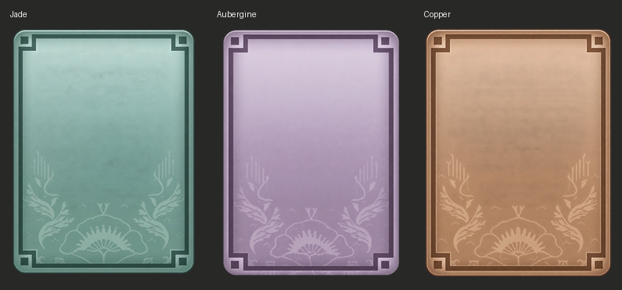

# Fixed blank character-card templates

Three blank bases generated once with the built-in `image_gen` tool from DP's specified `0_base_icon_grey.dds`, then exported to the native 240 × 320 canvas. The source is the Morgenröte blank card; this is an explicit template choice, while **foreground artwork continues to use exclusively Vanilla style references**.

| Family | Used for | PNG for composition | DDS |
|---|---|---|---|
| Jade | uSuthu, amaKhosi, constitutionally unaligned | [0_base_icon_jade.png](0_base_icon_jade.png) | [0_base_icon_jade.dds](0_base_icon_jade.dds) |
| Aubergine | Incumbent, rival claimant, personally uncommitted | [0_base_icon_aubergine.png](0_base_icon_aubergine.png) | [0_base_icon_aubergine.dds](0_base_icon_aubergine.dds) |
| Copper | Claimant, Mountain King | [0_base_icon_copper.png](0_base_icon_copper.png) | [0_base_icon_copper.dds](0_base_icon_copper.dds) |

These are the fixed bases for this set. Reusing each saved base makes the background identical within its family. They are **AI-generated recolourings, not pixel-for-pixel colour transforms of the original DDS**. Differences between the three generated templates are retained in these masters; no individual trait should regenerate or alter its family's base.

The original grey DDS was exported unchanged to [0_base_icon_grey_source.png](0_base_icon_grey_source.png). Exact source path, source hash, prompts, generated-image paths and output hashes are in [manifest.json](manifest.json). The three `*_generated.png` files preserve the original 1086 × 1448 outputs. The 240 × 320 PNGs use Lanczos downsampling; the DDS files contain the same RGBA pixels without lossy block compression. All three have alpha ranging from 0 to 255.

## Foreground workflow

Use the [revision 3 foreground prompts](../../../Docs/character_trait_icon_generation_prompts_2026_10_19_r3.md). Generate each greyscale subject separately with a genuinely transparent background. Supply its base for placement context only and unmodified Vanilla cards for artistic style. The generator must not return a painted card or background.

Composite the returned foreground onto the saved 240 × 320 PNG using ordinary alpha compositing. Do not send the assembled image back through generation for routine compositing. Preserve the base pixel-for-pixel wherever the foreground has zero alpha. Keep the frame above the subject where shafts or forearms meet its inner edge: clip the foreground to the actual inner field, leaving the original frame unchanged. No white/grey matte or generated colour fill should obscure the field.

Inspect the composited result at 240 × 320 and 60 × 80. Verify that the frame, outside alpha and all background pixels outside the subject/shadow match the fixed base exactly, then export the final card. Foreground generation, final compositing and runtime integration are still pending; this delivery contains blank templates only.
