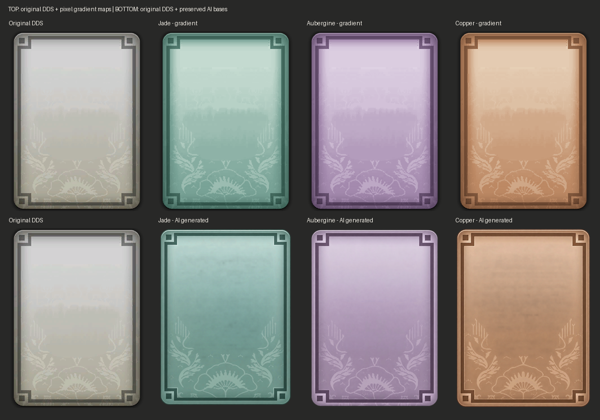

# Deterministic gradient-map templates

These three templates recolour the original `0_base_icon_grey.dds` at its native **240 × 320** resolution. No image generation, resizing, resampling, redrawing or spatial filtering is involved. Every original pixel stays at the same coordinate, and the alpha channel is copied byte-for-byte. Only RGB changes.

The earlier [AI-generated bases](../character_card_templates_2026_10_19/README.md), their original large outputs, DDS/PNG exports, manifest and prompts remain untouched. The build verified all 13 files against their pre-build hashes.

## Files and comparison

| Family | PNG | Uncompressed RGBA DDS |
|---|---|---|
| Jade | [0_base_icon_jade.png](0_base_icon_jade.png) | [0_base_icon_jade.dds](0_base_icon_jade.dds) |
| Aubergine | [0_base_icon_aubergine.png](0_base_icon_aubergine.png) | [0_base_icon_aubergine.dds](0_base_icon_aubergine.dds) |
| Copper | [0_base_icon_copper.png](0_base_icon_copper.png) | [0_base_icon_copper.dds](0_base_icon_copper.dds) |

All comparison cards are shown at native size with no alignment adjustment. The original is repeated in both rows for comparison. The visible outline is measured where alpha is at least 128; all canvases are 240 × 320:

| Version | Outline bounds: left, top, right, bottom | Outline size |
|---|---|---|
| Original DDS | 8, 3, 233, 317 | 225 × 314 |
| All three gradient maps | 8, 3, 233, 317 | 225 × 314 |
| AI jade | 4, 2, 236, 314 | 232 × 312 |
| AI aubergine | 8, 4, 232, 316 | 224 × 312 |
| AI copper | 2, 2, 238, 318 | 236 × 316 |

The generated variants therefore do differ in geometry. These measurements concern the outer alpha contour; they do not measure every internal border or decorative feature. For the deterministic versions, preservation is stronger than matching bounds: the complete alpha channel is identical, and the RGB mapping never moves or synthesises image features.

## Colour transformation

The grey-named source has a slight warm RGB cast. First calculate a single 8-bit luminance per pixel using `(299R + 587G + 114B + 500) // 1000`. Map that value through a piecewise linear gradient in sRGB channel values:

| Input luminance | Jade | Aubergine | Copper |
|---:|---|---|---|
| 0 | `#000000` | `#000000` | `#000000` |
| 80 — shadow | `#355B50` | `#55405E` | `#704A32` |
| 170 — field | `#79A397` | `#A48AAE` | `#BD8964` |
| 220 — highlight | `#D7E8DE` | `#E9DEED` | `#EEDCC5` |
| 255 | `#FFFFFF` | `#FFFFFF` | `#FFFFFF` |

Each source tone maps to exactly one output colour. The shared stop positions keep all three palettes structurally consistent. Brightness and colour contrast intentionally change with the gradient; original RGB values are not retained. The source shading and ornament remain in the same places. Dark source shadow pixels remain dark rather than becoming coloured edge halos.

The palette and stop positions are fixed in [build_templates.py](build_templates.py). The script records the source hash, formula, palette values, Pillow version, output hashes, alpha check, DDS/PNG pixel check and preserved generated-file hashes in [manifest.json](manifest.json). Rerunning it reproduces these outputs from the original DDS. It never writes into the generated-template folder.

## Use in the icon workflow

The [foreground prompts](../../../Docs/character_trait_icon_generation_prompts_2026_10_19_r3.md) now link these deterministic templates for placement context. Foregrounds still use unmodified Vanilla cards for artistic style and are generated on transparent backgrounds. Composite each foreground over its fixed base and retain the original frame above the subject at the inner edge. Foreground generation and runtime integration remain pending.
