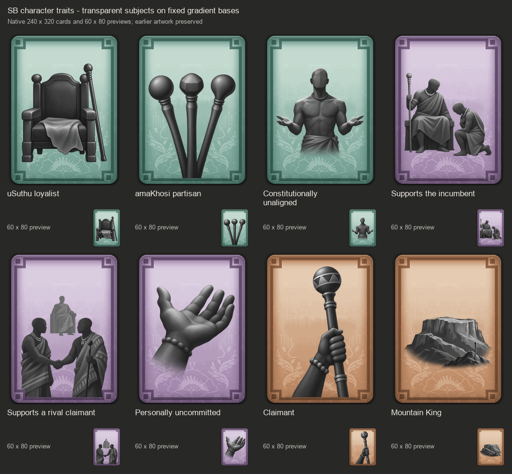

# Refined character-trait cards

**Later revision:** Mountain King's live asset now uses the [Vanilla special gold frame](../mountain_king_special_2026_10_19/README.md), at DP's request. The copper card and its original integration hashes below remain historical records. The other seven installed cards still match this set.

Eight transparent foregrounds generated with the **built-in image_gen tool** using the [revision 3 prompts](../../../Docs/character_trait_icon_generation_prompts_2026_10_19_r3.md), then composited onto the fixed [deterministic gradient-map bases](../character_card_templates_gradient_2026_10_19/README.md). Vanilla cards alone supplied the foreground rendering style. Earlier full-colour cards and both sets of blank bases remain intact.

## Selected deliverables

Each finished card is 240 × 320 RGBA. The DDS uses uncompressed RGBA and has exactly the same decoded pixels as its PNG. Original generated foregrounds are saved unchanged at 1086 × 1448.

| Card | Finished PNG | Finished DDS | Original transparent foreground |
|---|---|---|---|
| uSuthu loyalist | [PNG](usuthu_loyalist_card.png) | [DDS](usuthu_loyalist_card.dds) | [Foreground](usuthu_loyalist_foreground_v1.png) |
| amaKhosi partisan | [PNG](amakhosi_partisan_card.png) | [DDS](amakhosi_partisan_card.dds) | [Foreground](amakhosi_partisan_foreground_v1.png) |
| Constitutionally unaligned | [PNG](constitutionally_unaligned_card.png) | [DDS](constitutionally_unaligned_card.dds) | [Foreground](constitutionally_unaligned_foreground_v1.png) |
| Supports the incumbent | [PNG](supports_incumbent_card.png) | [DDS](supports_incumbent_card.dds) | [Foreground](supports_incumbent_foreground_v1.png) |
| Supports a rival claimant | [PNG](supports_rival_claimant_card.png) | [DDS](supports_rival_claimant_card.dds) | [Foreground](supports_rival_claimant_foreground_v1.png) |
| Personally uncommitted | [PNG](personally_uncommitted_card.png) | [DDS](personally_uncommitted_card.dds) | [Foreground](personally_uncommitted_foreground_v1.png) |
| Claimant | [PNG](claimant_card.png) | [DDS](claimant_card.dds) | [Foreground](claimant_foreground_v1.png) |
| Mountain King | [PNG](mountain_king_card.png) | [DDS](mountain_king_card.dds) | [Foreground](mountain_king_foreground_v1.png) |

The corresponding `*_foreground_240.png` files contain the positioned, clipped foreground layers used for assembly.

## Runtime integration

DP approved this set on 19 October 2026. All eight DDS files were installed byte-for-byte in `gfx/interface/icons/character_trait_icons/`; each filename is its trait ID followed by `.dds`. Mountain King was subsequently replaced by the gold revision linked above.

| Card | Runtime trait |
|---|---|
| uSuthu loyalist | `sb_court_alignment_royal_trait` |
| amaKhosi partisan | `sb_court_alignment_chiefly_trait` |
| Constitutionally unaligned | `sb_court_alignment_neutral_trait` |
| Supports the incumbent | `sb_court_endorsement_incumbent_trait` |
| Supports a rival claimant | `sb_court_endorsement_claimant_trait` |
| Personally uncommitted | `sb_court_endorsement_uncommitted_trait` |
| Claimant | `sb_court_claimant_trait` |
| Mountain King | `sb_moshoeshoe_lifeline` |

Claimant is a display-only distinction for an existing rival endorsement naming the character themselves. It replaces the supporter card on that character; backing someone else keeps Supports a Rival Claimant. The existing refresh updates the display after changes of allegiance. Constitutional traits, broader ideologies and all gameplay bonuses retain their existing behaviour. The new Claimant label and description are queued for DP prose review.

## Composition and verification

[compose_cards.py](compose_cards.py) performs only the authorised mechanical assembly: crop transparent margins, preserve aspect ratio while scaling, position within the native field, clip at the stepped frame and alpha-composite. Small generated RGB differences were normalised to exact greyscale in the derivative layers; untouched generated originals remain available. The bases are never resized or repainted.

The original frame sits above the lower ends of the chiefly staffs, claimant's forearm and rival-support figures. The native alpha and all background pixels not covered by a subject remain identical to the fixed base. These conditions are checked for every card, along with PNG/DDS pixel parity and unchanged base-file hashes.

Visual review covered the full-size generated subjects, the native 240 × 320 composites and 60 × 80 previews. The neutral figure, single open hand and royal seat have distinct silhouettes. The kneeling pledge and foreground handshake read as different relationships. The small seated incumbent remains secondary in the rival-support card. DP approved the artwork; in-game rendering remains pending DP.

[generation_jobs.json](generation_jobs.json) records the exact prompts and ordered references used. [manifest.json](manifest.json) records original source paths, hashes, dimensions, transparency measurements, crop/scale/placement, export hashes, installed paths and verification. All 29 court tests pass, including display-only behaviour, self-claim versus supporter and eligible-heir states, exile, repeated refresh and allegiance changes. No game launch was performed.

Full validation: **15/17 gates passed, warned or skipped**. Unit discovery ran 588 tests: 579 passed, one failed and eight skipped. The unit failure and localisation-gate failure report the same existing reviewed-prose drift in `sb_klip_river_county.060`, `sb_klip_river_county.080` and `sb_natal_crisis.050`, all in `sb_natal_crisis_l_english.yml`; this integration did not edit those namespaces. CMF, override, map, naval and runtime-contract checks passed. Tiger remains advisory because its 1.13.5 parser is checking 1.14.5; its report contains no diagnostics for the two trait-definition files or the allegiance-sync effect. DP's in-game rendering and trait-tooltip checks remain pending.
