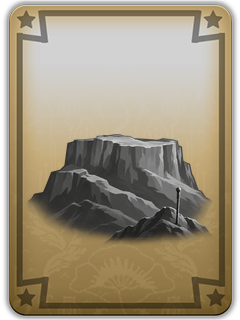

# Mountain King — Vanilla special gold frame

DP requested Vanilla's distinctive special-character frame, including its four corner stars. The approved greyscale mountain and staff retain their original size and position; the earlier [copper card](../character_traits_foregrounds_2026_10_19/mountain_king_card.png) and every generated source remain intact.

## Assembly

Vanilla supplies twenty finished special cards rather than a separate blank template. [build_card.py](build_card.py) recovers their common frame and background pixels. Where the sources disagree, it estimates the surrounding field colour and selects the nearest actual Vanilla pixel at that coordinate. It then composites the unchanged approved `mountain_king_foreground_240.png` over that field. No new image generation, frame recolouring or foreground resampling was used. This is a reconstruction for this finished card, not a claim to have recovered an exact general-purpose blank template.

Run `python3 build_card.py` with Pillow and NumPy installed to reproduce the PNG, lossless RGBA DDS and [source/hash manifest](manifest.json). The script does not install the result. The DDS has been copied to `gfx/interface/icons/character_trait_icons/sb_moshoeshoe_lifeline.dds` in SB.

## Verification

- 240 × 320 RGBA; decoded PNG/DDS pixels are identical.
- Native exterior alpha, frame and corner stars survive the composite unchanged.
- Fully opaque foreground pixels, foreground dimensions and placement are unchanged.
- Runtime DDS is byte-identical to this export; the other seven installed court cards retain their earlier hashes.
- Visual inspection completed at native size. In-game rendering remains pending DP; the game was not launched.
